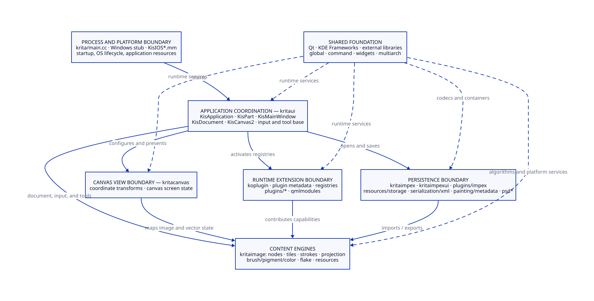
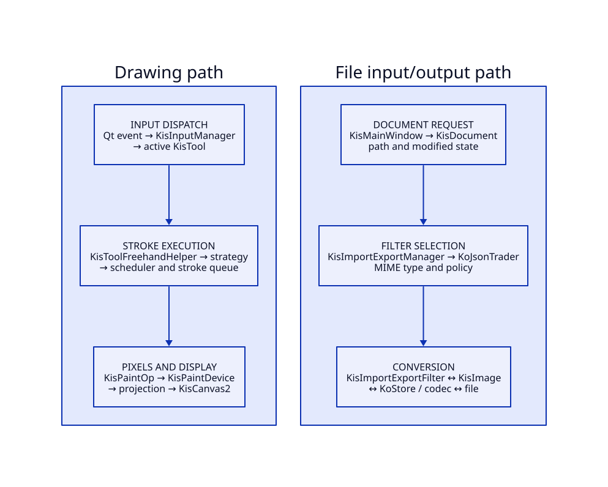
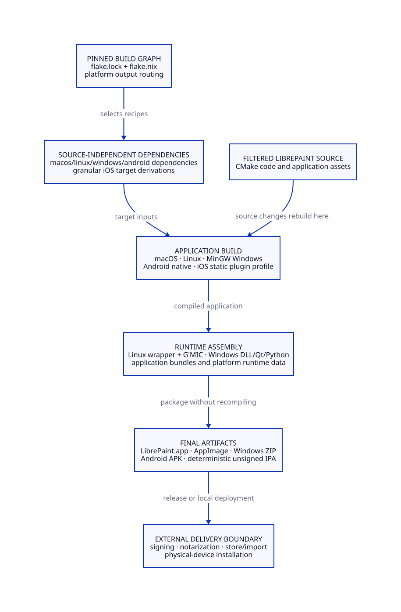

# LibrePaintアーキテクチャガイド

## 目的

この文書は、変更内容から調査対象を絞り、LibrePaintの主要な設計境界と実行経路を把握するための入口です。設計判断に使う責務、経路、識別子を中心にまとめています。

作業の目的、前提、完了条件と検証結果は[GitHub Issues](https://github.com/serika12345/librepaint/issues)、
着手順と進行状態は[GitHub Projects](https://github.com/users/serika12345/projects/2)で管理します。
開発・検証コマンドと作業管理の手順は[LibrePaint開発マニュアル](DEVELOPMENT.md)を参照します。

- 変更を共通コード、プラグイン、プラットフォーム統合、配布定義のどこへ置くか
- 起動、描画、ファイル入出力がどの境界を通るか
- CMakeターゲット、実行時プラグイン、Nix出力の違い
- 調査時に最初に読むファイルと、その次に追う識別子

図は責務と主要な実行経路を示します。実際のリンク境界は各ディレクトリーの
`CMakeLists.txt`を正本とします。

## 全体構造

図の編集元は[code-architecture.d2](code-architecture.d2)です。

### パッケージ境界

[パッケージ境界方針](package-boundaries.json)は、責務と中核所有ターゲット、
責務間で許可する直接リンク方向だけを保持する。所有ターゲットは一つの責務へ一意に属し、
許可方向は有向非巡回グラフを形成する。

| 責務ID | 中核所有ターゲット | 対象 |
| --- | --- | --- |
| `application-configuration` | `kritaapplication` | 設定値、スナップ方針、プラットフォームのファイル交換 |
| `application-orchestration` | `krita`、`kritaapplicationui` | 起動、OSライフサイクル、ウィンドウ、作業空間 |
| `canvas-presentation` | `kritabasicflakes`、`kritacanvas`、`kritaflake`、`kritaworkspacepresentation` | 座標変換、キャンバス、ベクター、作業空間表示 |
| `document-lifecycle` | `kritadocument`、`kritadocumentfiles`、`kritadocumentui` | 文書寿命、変更状態、保存、取り消し、文書表示 |
| `import-export` | `kritaimpex`、`kritaimpexui` | 形式選択、検証、文書入出力、結果通知 |
| `input-interpretation` | `kritainput`、`kritainputui` | ポインター、キーボード、タッチ、タブレット、ショートカット |
| `painting-rendering` | `kritacolor`、`kritaimage`、`kritalibbrush`、`kritapainting`、`kritapaintingmetadata`、`kritapaintingundo`、`kritapigment` | 色、ブラシ、画像、投影、ストローク、描画、メタデータ |
| `plugin-infrastructure` | `kritaplugin` | メタデータ探索、ファクトリーとサービス種別の登録 |
| `resource-management` | `kritaresources`、`kritaresourcestorage`、`kritaresourceui` | リソースの保存、検索、タグ、選択、表示 |
| `tool-invocation` | `kritatools`、`kritatoolsui` | ツール命令、描画設定表示、キャンバス状態への呼出し |

`scripts/architecture/check_package_boundaries.py`は、高速検査で方針の所有一意性、
参照整合性、許可方向の非循環性を検査する。各プラットフォームの
`build-incremental <platform> configure`はCMake File APIの問い合わせを構築木に作成し、
構成直後の応答から中核ターゲットの存在、実際の直接リンク方向、全製品ターゲットの循環を
検査する。実構成が正本であり、生成したターゲット台帳は保守しない。

### 公開ヘッダーとプラグイン登録

`scripts/architecture/check_public_contracts.py`は、製品ソースと登録JSONを直接調べる。
所有パッケージの外から利用されるヘッダーには、所有ターゲットの公開マクロまたは公開ヘッダー
構築契約が必要である。

製品プラグインは登録マクロと兄弟JSONを一対一で持ち、IDが一意で、既知のサービス種別を
一つ宣言する。登録マクロ、JSONの存在、IDとサービス種別の整合性を直接検査する。
ターゲットの所有とリンク方向はCMake構成に基づく依存検査が担当する。

`libs/global/KoID.h`は識別子と表示名の共有値契約を所有し、遅延翻訳の格納実装は
`libs/global/KoID.cpp`が所有する。`KLocalizedString`の生成や翻訳関数を使用する利用元は
`<klocalizedstring.h>`を直接取り込み、`KoID.h`はBoost optional、`KisLazyStorage`、翻訳実装を
利用元へ伝播させない。

### 責務別の所有先

各責務は、所有ディレクトリー、公開APIの名前空間、主CMakeターゲットを次のように
対応付ける。新しい公開APIは対応する責務名前空間を使用し、所有ターゲットの公開面へ登録する。

| 責務 | 所有ディレクトリー | 新しいAPIの名前空間 | 主ターゲット |
| --- | --- | --- | --- |
| プラグイン基盤 | `libs/koplugin` | `Krita::Plugin` | `kritaplugin` |
| リソース管理 | `libs/resources` | `Krita::Resources` | `kritaresources` |
| 画像・描画操作状態 | `libs/image` | `Krita::Image` | `kritaimage` |
| 描画 | `libs/painting` | `Krita::Painting` | `kritapainting` |
| 入出力 | `libs/impex` | `Krita::ImportExport` | `kritaimpex` |
| キャンバス表示 | `libs/canvas` | `Krita::Canvas` | `kritacanvas` |
| 文書寿命 | `libs/document` | `Krita::Document` | `kritadocument` |
| ツール呼出し | `libs/tools` | `Krita::Tools` | `kritatools` |
| 入力解釈 | `libs/input` | `Krita::Input` | `kritainput` |
| アプリケーション設定 | `libs/application` | `Krita::ApplicationConfiguration` | `kritaapplication` |
| アプリケーション調整 | `libs/application/ui` | `Krita::Application` | `kritaapplicationui` |

パッケージ境界方針、実CMakeグラフ、公開契約の直接検査が、現在の所有、依存方向、
有向非巡回性、公開ヘッダー境界を継続して確認する。

`libs/ui/tool`の公開ヘッダーは、画面表示、入力、ストローク作成、描画実行を接続する
`kritaapplicationui`所有の実装である。ツール命令と設定値は`libs/tools`、設定表示は
`libs/tools/ui`が所有する。既存の公開大域C++識別子は確立済みのAPI・ABI名を維持し、
新しいAPIは上表の責務名前空間を使用する。`kritaapplicationui`が生成する
`KRITAUI_EXPORT`と生成ヘッダーの`kritaui`基底名は、既存ABIの公開名を維持する。

### 保存領域と描画実行

`libs/resources/storage`の`kritaresourcestorage`はZIPとディレクトリーの保存を、
`libs/serialization/xml`の`kritaxmlserialization`はXML名前空間と逐次書出しを所有する。
保存側はQt Core、KConfig、QuaZip、XML側はQt Coreを利用し、上位の製品所有者から独立する。
`libs/resources/ui`は資源の選択・タグ表示を、`libs/tools/ui`は描画設定の表示を担当する。

`libs/painting/strokes`はストローク実行、`libs/painting/undo`は画像・キャンバス向けの
取り消し処理、`libs/painting/metadata`は画像メタデータを所有する。
画像層が利用する`kritapaintingundo`と`kritapaintingmetadata`を、画像層を利用する
`kritapainting`から分けることで、依存方向を一方向に保つ。
資源スナップショットは`libs/resources`の読出し接続面を保持する。

図形描画は`libs/painting/kis_figure_painting_stroke.{h,cpp}`が所有し、
`KisFigurePaintingStroke`の寿命がストロークの開始、ジョブ追加、終了をまとめる。
描線・塗り値は`KisFigurePaintingOptions.h`が定義し、列挙値の順序とスクリプトの
スタイル名との対応を維持する。
`libs/painting/kis_resources_snapshot.{h,cpp}`はGPU入力と図形描画が使う円形ブラシの
色・径・不透明度・合成・対称軸と対象レイヤーを値として固定する。UIは入力と診断通知を接続する。
GPU図形描画は画像とノードの寿命を保持し、直線の筆圧と矩形・楕円・頂点列を一回の履歴へ確定する。
公開APIは指定されたノードへ描画し、画面の選択対象を維持する。
公開レイヤー参照による描画は、ノードが所属する画像を使用する。複製後に挿入したレイヤーも
同じ描画所有者と履歴へ接続する。
GPU図形の輪郭指定と単色の塗りは、独立した色と形状を一つの操作として保持する。
円形マーカーは大きい被覆を採用し、同じ完全被覆では先に塗った色を保持する。
`libs/global/kis_algebra_2d.h`の半平面判定は、行列式の積の丸め誤差を補正し、
境界上の点と隣り合う浮動小数点座標の側を区別する。
画面の色見本はRGB値を提供し、透明度は被覆と描画の不透明度で決める。
公開APIの確定した図形は、一度の文書通知と履歴で採用する。通常ツールは未確定の版を通知し、
タブ終了と入力取消しを確定前に受け付ける。描線と塗りのない図形要求も、画素を保った一回の履歴として記録する。
公開APIの経路描画は、移動・直線・三次曲線の命令列と制御点を保持する。
経路の区切り、交差の偶奇と巻き数による塗り規則を固定し、空の経路も画素を保った一回の履歴へ確定する。
入力の複製は操作所有者の上限内で行い、制御点も入力点の予算に含める。
パターン塗り、ペン描画と複数回の図形呼出しを一操作へまとめる描画は、対応する資源・操作表現が必要なため
確定前に拒否する。通常文書の図形描画は既存のストローク処理を使用する。
色採取は`libs/painting/KisColorSamplerStroke.{h,cpp}`が実行し、採取ジョブの後に
完了ジョブとストローク終了を並べ、最後の採取色を一度だけ確定通知する。
UI側は対象画像、参照画像、キャンバス色資源、カーソルとプレビューを接続する。

`libs/image/tiles3/swap/kis_lzf_compression.{h,cpp}`はKRAとタイル保存で使うLZF形式の
圧縮・展開を所有する。`kritaimagecompressionobjects`はQt Coreだけに依存し、
形式処理から画像や描画実行の生成を必要とせず利用できる。
展開は入力全体と出力容量を検査し、通常の連続値と最大8,192バイト前までの参照を復元する。
不完全な記録や容量不足は0を返し、利用側は途中まで書かれた出力を破棄する。

`libs/image/tiles3/kis_tiled_data_manager.cc`は、既存画像のKRA保存で使う画素タイル列を
行・列の昇順で書き出す。負座標を含めてタイル参照を並べ、画素を既存のLZF圧縮処理へ渡す。
生成順の異なる同じ画素と、読込み後の再保存は同じタイル列を生成する。
文書ヘッダーと各タイルのヘッダー・画素の書込み失敗は、その場で失敗として返す。
保存側は途中の出力を破棄し、編集画素と履歴を保持する。形式2と既存の読込み順の互換性を維持する。

`libs/image/tiles3/kis_tile_data_store.cc`は、既存画像の画素バッファーの確保・複製と管理対象への登録を
同じ走査用ロックで保護する。文書終了時のメモリー回収は登録済みのバッファーを列挙し、
画素を保持して領域を組み直す。新しいバッファーが必要な場合は、空き容量の待機と複製元の読込みを
終えてから、登録を守る読取りロックを取得する。

### 入出力と文書寿命

通常の文書操作は、既存のブラシ、色精度、レイヤー階層、選択・マスク、効果と形式の利用可否を維持する。
GPU実装の製品採用は、対応する通常操作、公開API、ファイル往復と環境間一致の受入れを単位とする。
限定した画像所有者の検証結果は、その範囲の根拠として扱う。通常経路への採用と旧処理の撤去条件は
[#87](https://github.com/serika12345/librepaint/issues/87)、
[#89](https://github.com/serika12345/librepaint/issues/89)、
[#91](https://github.com/serika12345/librepaint/issues/91)が所有する。

#### 保持する描画操作と文書版

`libs/image/gpu/KisGpuOperationDocument.{h,cpp}`は、`LibrePaint::Image::Gpu`の
`OperationDocument`として、円形ブラシの設定、乱数種、筆圧・傾き・回転・時刻を含む入力、
自由描画・直線・楕円・矩形・角丸矩形・折れ線・多角形・経路の形状、レイヤーの種類と親子関係をCPU値として保持する。
透明度保護とRGBA各チャンネルの書込み可否は描画開始時のブラシ設定として保持し、
描画中の画面設定とレイヤー設定の変更から独立する。レイヤーの保護設定は文書版と履歴に属し、
公開レイヤーAPIと通常パネルが同じ状態を利用する。
折れ線と多角形は入力列を制御頂点として保持し、多角形の閉じる辺を派生する線分として生成する。
操作・履歴・復旧・圧縮画素の値は、Qt Coreとzlibに依存する共有ライブラリ
`kritaimagegpuoperations`が所有する。形式処理はこの値の所有者を直接利用する。
GPU実行・派生画素・画像接続の共有ライブラリ`kritagpuimage`は、その操作の値と
wgpu-nativeに依存する。`kritaimage`は公開画像APIの接続を所有し、表示側は
`kritagpuimage`の公開境界からGPU画素と実行を利用する。

実装ファイルは`libs/image/gpu/`に置き、`libs/image/gpu/CMakeLists.txt`が両所有者を構築する。
`KisGpuOperationDocument.cpp`、`KisGpuOperationRecovery.cpp`、`KisGpuRasterPixels.cpp`、
`KisGpuRasterOperations.cpp`は操作の値に属する。`KisGpuPaintGeometry.cpp`、
`KisGpuDevice.cpp`、`KisGpuExecution.cpp`、描画・合成・読取りと`KisGpuPaintImage.cpp`は
GPU実行の所有者に属する。公開ヘッダーは各所有者の生成した公開シンボル宣言を使う。

`KisGpuRasterPixels.{h,cpp}`はRGBA8の256×256画素ブロックを圧縮した不変値として保持する。
展開は固定長の出力領域を使い、展開長、圧縮入力の消費量、座標の範囲を検査する。
透明画素に格納したRGB値と、キャンバス外のタイルも保持する。
`KisGpuRasterOperations.cpp`は画像の読込値と階層を検査して採用し、レイヤー名、UUID、
表示状態、位置、選択レイヤーを保持した保存済み版から開始する。
レイヤー位置はKRAの符号付き32ビット整数を保持し、画素タイルは画像座標で解釈する。
公開ノードと保持された画素参照は画像所有者の位置を読み、複製・挿入と保存は同じ位置を渡す。
KRA形式所有者は画像の固定版から渡された位置を`x/y`へ書き出す。
各レイヤーは未配置の画素に使うRGBA8の既定値を保持し、キャンバス外も同じ規則で解釈する。
外部処理によるタイル置換は、圧縮画素を保持する一操作として描画と同じ履歴へ入る。

開始、標本追加、形状更新、確定、取消しを一つの所有スレッドで扱う。
標本追加は要求全体を検査してから採用し、上限超過や不正値では直前の入力を維持する。
入力の共有ブロックは分割境界に描画上の意味を持たせず、固定版間で共有する。
確定は現在のプレビュー版を一操作として履歴へ採用し、取消しは元の文書版とRedo側を保持する。
レイヤー追加・改名・並替え・削除・表示変更と描画は標準250操作の同じ履歴へ入り、
Undo／Redoは保持済みの版を選ぶ。並替えは選択したレイヤーの識別を保持する。
削除は残る列の近傍を選択し、最後のレイヤーを削除した文書は選択なしの空文書として保持する。
空文書もGPUの透明な投影、復旧、KRA保存・再読込みを扱う。
選択レイヤーの切替は画面状態として扱う。

保存調整側は確定版を保持して処理し、保存成功後にその版を`markSaved()`へ渡す。
後続編集がある場合は変更済み状態を保持する。固定版は所有者の終了後も参照できる。
操作識別子は文書セッションと連番を持ち、取消し・終了・復旧前の識別子を拒否する。

直接画素書込みは履歴数、Redo側と変更済み状態を保ち、同じ画素を共有する履歴版へ書込みを
採用する。履歴の画素共有は64×64の範囲で識別し、同じGPUタイル内の別領域を保持する。
輪郭と単色塗りの範囲を共有依存として保持し、塗りの前と後の画素版を分ける。
キャンバス外と鏡像の描画も同じ範囲判定を使い、別の履歴の画素を保つ。
画素の版は更新し、保存対象として固定済みの不変版を保持する。
画素の版と履歴上の変更版を個別に識別し、同期的な外部書込みが保存状態を変えるかどうかを保つ。

レイヤーの不透明度はGPU合成へ適用し、レイヤーの元画素を保持する。ロックしたレイヤーへの
描画開始は拒否する。不透明度とロックの変更は共通の履歴で扱い、復旧とKRA保存にも保持する。
キャンバス背景色は文書版に保持し、GPUの一様なタイルを合成の土台にする。透明な背景で
完全不透明のペイントレイヤーが1枚の場合は、その画素を投影として読み取る。
複数レイヤーの合成では、完全に透明な画素の色を投影の背景色から決め、元レイヤーの画素を保持する。
投影の再利用は入力タイル、不透明度と単独レイヤーとして読む条件を照合する。
読込時の画素とGPUの描画規則から透明画素の色の有無を判定し、変換が必要な場合に合成用タイルを確保する。
公開APIによる背景色の書込みは、履歴の位置、Redo側、未確定入力を保ち、履歴版の背景を更新する。
保存などで固定した版は変更前の画素を保持する。画像所有者はGPU要求を更新し、
公開APIの呼出し側が変更済み状態と通知を扱う。背景色変更の通知中に文書を終了または
画像を交換した場合は、その画像への後続の更新要求を止める。

レイヤーの複製は、選択した部分木を元の階層順で追加し、一件の履歴として確定する。
親子を同時に選んだ場合は、親の部分木を一度複製する。複製先は最上段の選択の親とし、
ロックされた祖先の上までたどって編集可能な親を選ぶ。異なる親からの選択も同じ複製先へ追加する。
操作所有者は親のUUIDと兄弟順から対象の部分木をたどり、親子の列挙順にかかわらず配置と操作対象を決める。
各複製は独立したレイヤー・操作の識別子を持ち、元の入力標本と圧縮画素を共有する。
複製のUUIDは元のUUIDと新しいレイヤー番号からUUIDv5で決め、既存識別子との衝突は
有限の候補列から解決する。同じ文書と操作順は同じ永続化識別子を生成する。
変更前の版、複製元の画素、チャンネル保護と属性を保持し、複製後の編集はそのレイヤーへ適用する。
操作対象と複数選択は画面状態として更新し、Undo／Redoでは対象版の選択へ復元する。
操作対象は選択集合から独立し、対象を選択から外した状態も保持する。
公開画像はレイヤーツリーの同期状態を提供し、UIは同期後の選択を採用する。
グループと描画レイヤーをまとめて複製するときも、画像側がUUIDから選択した部分木の複製ノードを解決し、
その選択をUIへ通知する。操作対象と選択は、部分木の全体番号から独立して保持する。

公開APIの未挿入レイヤー複製は、そのレイヤーの保持版から独立したGPU画像を作る。
入力と圧縮画素を共有し、操作識別子と編集先を分ける。削除済みレイヤーの保持版も
複製でき、共有する実行所有者は最後の画像参照の解放まで生存する。

レイヤー属性の直接書込みは履歴位置、Redo側、変更済み状態と未確定入力を保つ。
同じ属性の記録済み操作が区切る版の範囲へ値を採用し、固定済みの版を保持する。
属性操作は変更前・変更後の値を保持し、直接書込み後もその値へUndo／Redoする。
複数段階の履歴移動は全段階の成功後に採用し、失敗時には版列、位置と連番を保持する。
レイヤーパネルの連続した名前・不透明度変更と表示・ロック切替は、同じ属性・レイヤーの一件へまとめる。
保存済み位置と独立した編集は区切りを保持する。変更前へ戻った不透明度・表示・ロックは履歴から取り除き、
名前の変更は通常文書と同じ取消し可能な一件を保持する。固定済みの版は結合前の値を保つ。

`libs/image/gpu/KisGpuOperationRecovery.cpp`は内部の復旧形式35を所有し、形式9〜34の記録も読み込む。
形式11は角丸矩形の回転に続けて二軸の半径を記録し、折れ線・多角形の頂点を入力列として保持する。
旧形式の形状は半径ゼロで読み込む。
形式12はブラシの一バイトのフラグに消去と透明度保護を保持する。形式9〜11は消去のフラグを読み、
透明度保護を無効として復旧する。形式13はブラシとレイヤーのフラグに書込み禁止の
RGBAチャンネルを保持し、属性履歴にもその値を保持する。形式9〜12は全チャンネルを書込み可能として読む。
形式14は左右・上下の対称設定と整数画素の軸位置を描画操作へ保持する。
対称描画は元の入力列から反射先のタイルを求め、GPUで被覆を統合して一度合成する。
軸上で重なる筆跡の不透明度を保持し、描画開始後の対称設定変更は次の操作へ適用する。
形式15は操作対象と複数レイヤーの選択、複製の操作名を各履歴版へ保持する。単独選択は操作対象から復元し、
複数選択は上限内の識別子列として記録する。形式9〜14の選択は操作対象の一枚として読む。
形式16は操作対象を含まない選択集合を保持する。対象と異なる単独選択も識別子列として記録し、
対象の有効性、選択の重複とレイヤー順を文書の置換前に検査する。
形式9〜13は対称描画を無効として読む。形式に対応しないフラグは文書を置換する前に拒否する。
形式10から変更前へ戻った名前の履歴を表現する。履歴結合の操作区切りは復旧後の新しい編集から開始する。
文書寸法と背景色、レイヤーUUID、既定画素、不透明度、ロックとタイムラインへの固定、共有する描画操作と圧縮タイル、履歴の両方向、保存済み版、
画素版、変更版、属性操作の変更前・変更後の値、画素共有の識別子と変更領域、未確定操作を記録し、SHA-256で記録全体を
照合する。復旧は容量、値域、識別子、参照、履歴順、入力時刻、UTF-8を検査してから一括採用する。
復旧した操作には新しいセッション識別子を付ける。通常のKRA形式は入出力所有者が担当する。
形式17は図形の輪郭指定と単色塗りのRGBA値を保持する。旧形式の描画操作は輪郭あり・塗りなしとして読む。
描線と塗りのない操作も、画素を維持した履歴として復旧する。
形式18は経路の命令列と塗り規則を保持する。三次曲線の命令は入力列の制御点二つと終点を使用する。
入力を持たない空の経路は、確定した操作と未確定の操作の両方を復旧する。
形式19は自由描画のピクセル補正設定を保持する。旧形式は補正なしとして読む。
形式20は基本補正の設定、入力停止時の標本数、確定した操作と未確定操作の区別を保持する。
停止位置は入力順に検査し、入力範囲と設定・確定状態の整合を確認してから復旧する。
形式21は正規化した入力速度と加重補正の距離・末尾の強さ・筆圧補正を保持する。
旧形式の入力速度はゼロとし、加重補正を無効として読む。設定と速度の値域を採用前に検査する。
形式22はレイヤー消去、形式23はキャンバス内の色塗りつぶしの履歴種別を保持する。
直接画素書込みと復旧の後も、操作の意味をUndo／Redoの表示へ渡す。
形式24は各履歴版のレイヤー位置を保持する。形式9〜23は位置を原点として復旧する。
形式25は整数移動、移動前後の位置と未確定の移動を保持する。
`KisGpuLayerTranslation.cpp`は元の描画入力を保持したまま移動量を記録し、
一回の確定を一履歴にする。取消しは確定版とRedoを保持する。
公開APIの絶対位置変更は、位置の履歴で区切った画素版と、削除後に保持した画素参照へ反映し、
履歴位置と保存済み状態を保持する。移動中の画素参照はプレビューを読み、取消しと文書終了で確定版へ戻る。
`KisGpuTileTranslation.cpp`と`shaders/translate.wgsl`は移動前のタイルから整数位置へRGBA値を転記する。
描画器は移動の前後で必要な領域を逆算し、描画・移動・後続描画を操作順に送信する。
透明画素のRGB値を含む内容境界をGPUで集約し、座標範囲から画素が失われる移動を採用前に拒否する。
直接画素書込みはレイヤー位置に対応する共有領域を履歴間で照合する。
移動ツールは変更通知後の所有者と操作識別子を確認し、取消し後の画素と座標表示を保持する。
形式26はレイヤーの切り抜き範囲と操作対象、一件の履歴を保持する。
`Node.cropNode()`と切り抜きツールのレイヤーモードは、`KisImage::cropNode()`から
GPU画像所有者へ接続する。範囲内の元画素、レイヤー位置、既定画素と選択を保持し、
範囲外をレイヤーの既定画素へ戻す。空範囲と全画素を含む範囲も一件の履歴を持つ。
公開APIはロックした対象にも適用でき、通常ツールは編集可能な対象を操作する。
`KisGpuTileCrop.cpp`と`shaders/crop.wgsl`は内側のタイルを共有し、境界タイルのRGBA値だけを
GPUで転記する。以後の描画と直接画素書込みは切り抜き範囲の外にも記録できる。
直接画素書込みの履歴照合はレイヤー位置に従う64×64画素のブロックを単位とする。
切り抜き前に存在したブロックの削除・部分消去は切り抜きの履歴へ帰属し、
未使用だったブロックと全体を保持したブロックへの書込みはUndo／Redo後も保持する。
先行する切り抜きで全面削除したブロックは、その後の切り抜きから独立する。
文書履歴は元の指定範囲と対象ノードを切り抜きツールへ渡し、再編集開始時のUndoと範囲の復元を支える。
通知中の文書終了では画像を保持し、ツールの破棄を確認してから継続する。
CPU文書の処理訪問経路は、階層・マスク・フレームの対応、通常文書の移行と各対象OSの受入れを経て撤去する。
形式27は履歴版ごとのキャンバス寸法と、画像全体の切り抜き・キャンバス変更の元範囲を保持する。
`KisGpuCanvasResize.cpp`は指定範囲の原点を画像原点へ移し、画像全体の切り抜きでは全レイヤーの
画素を先に範囲内へ制限する。非表示・ロックを含むレイヤーの属性と選択を保持し、一件の履歴へ採用する。
キャンバスだけの変更は範囲外の画素を保持し、変更のない要求は現在版と履歴を保持する。
移動後の画素が座標範囲を超える要求は、GPUで集約した内容境界から採用前に拒否する。
`Document.crop()`、`Document.resizeImage()`と切り抜きツールの画像・キャンバスモードは、
`KisImage::resizeImageImpl()`からGPU画像所有者へ接続する。GPU画像の分岐はCPUの処理訪問と
画像寸法コマンドに代えて、`KisGpuImageView.cpp`が採用した寸法と表示の固定点を通知する。
Undo／Redoは寸法、位置、画素とツールの再編集範囲を同じ履歴版へ戻す。
通常ツールは拒否を通知し、編集範囲を保持して再試行できる。
形式28は、移動したレイヤーの直接画素書込みと履歴付き画素置換の範囲を保持する。
64画素に整列しないレイヤー位置でも、履歴ブロックをGPUタイル内の互いに重ならない矩形へ
分けて記録する。一つのGPUタイルに入る矩形は最大25個とし、重複、タイル越境と領域外を
採用前に拒否する。形式27以前の読込みは、その形式の整列条件と領域数の上限を検査する。

形式29は、各履歴版のレイヤーの種類と親グループのUUIDを保持する。復旧と画像の採用は、
親の存在と種類、UUIDの一意性、循環の有無を検査する。形式28以前は親を持たない描画レイヤーとして読む。
グループの削除と複製は子孫を含めて一件の履歴へ記録し、複製した階層は親のUUIDを写し替える。
文書の複製は全階層を保持し、レイヤー単独の複製は指定した部分木を独立した文書として保持する。
キャンバスの変更は描画レイヤーの画素と位置を更新し、グループの画素は子から再生成する。
形式30は描画レイヤーとグループの色ラベル番号を保持する。形式29以前の色ラベルはゼロとして読む。
KRA情報を保持する文書の旧記録は、その情報にある色ラベルをUUIDで対応付けて採用する。
形式30以降で明示した値を優先し、文書と履歴を一括で公開する。
色ラベルの直接変更は、レイヤーが存在する履歴版と未確定入力の版へ反映し、保持した旧版と
履歴位置を維持する。ラベルの表示色と利用できる番号の集合は画面の設定が所有する。
形式31は各レイヤーが親へ合成するRGBA成分を保持し、形式30以前は全成分を合成する指定として読む。
履歴の属性種別255は合成成分の変更を表し、変更前後の一バイト値を保持する。
形式32の属性種別254は複数レイヤー・複数属性の一括変更を保持する。
各属性のレイヤー識別子、種別と変更前後の値が、後続の直接書込みとUndo／Redoの区切りを定める。
色成分の属性は確定対象のRGBA成分も保持し、対象外の成分への後続書込みを保つ。
読込みは属性数、識別子、値の範囲と重複を検査して、文書と履歴を一括で採用する。
形式33はグループの通過指定を各版に保持し、属性種別253を単独の通過指定変更に使う。
形式32以前は独立合成として読み込む。一括属性変更にも通過指定を含め、描画レイヤーへの通過指定と
一バイトの真偽値の範囲外を、文書の採用前に拒否する。
形式34は各レイヤーの合成方式を保持し、通常を0、乗算を1として記録する。
形式35はスクリーンを2として追加し、形式34の入力は通常と乗算の範囲で検証する。
単独の変更は属性種別252、一括変更は対象属性の一つとして変更前後の方式を保持する。
形式33以前は通常合成として読み、方式の範囲外を文書と履歴の採用前に拒否する。
属性ダイアログは画面が保持する変更前後の値を、画像所有者の一件の履歴へ確定する。
確定対象の属性は値が同じ場合も履歴に含め、複数選択で変更対象から外した属性は保持する。
開始時の固定版は属性の元値を保持し、確定通知は採用した値を伝える。
編集中に完了した描画・階層変更は現在版へ残す。取消しは元の8ビット値を直接復元し、
履歴位置、Redo側、未確定入力と対象外の色成分への書込みを保持する。
プレビューと取消しはGPUの変更通知を使い、CPU画像の更新コマンドはCPU文書が所有する。
描画入力中の確定と、文書が表現できない合成方式の確定は画面で拒否し、編集状態を保持する。
アルファ継承は合成先のアルファを保持して選択した色成分を混色する。
レイヤーパネルの切替はGPU所有者の属性履歴を使い、直接の属性書込みは履歴位置と保持した旧版を保つ。

`KisGpuLayerProjectionValues.cpp`は、子の既定画素、表示状態、不透明度、合成成分と順序から、
グループの一様な既定色を通常投影と同じ単精度の丸め規則で計算する。保持する画素の正本はGPUに属する。
`KisGpuTileRenderer.cpp`と`KisGpuTileProjection.cpp`は、子グループから親グループへGPUで合成する。
独立合成グループは子の合成結果を親へ渡し、自身の不透明度をその段階で一度適用する。
通過グループは、その合成先へ子孫を順に展開する。各子の不透明度は、通過する親の有効な
不透明度との積を255で割り、各段階で整数へ切り捨てる。合成成分は直上の通過親の元の成分指定と
組み合わせる。`DocumentVersion::projectionInputs()`が合成の入力列を定め、既定色とGPU画素で共有する。
非表示の部分木は表示用の画素生成から外し、表示に使う通過グループ自身の画像生成を省く。
明示したグループの投影・サムネイルは、透明な背景上にその子孫を合成した像を使う。
対象自身の可視性・不透明度・成分指定と、外側の祖先・背景・兄弟は単体像の外側に置き、
子孫の属性と通過・独立合成の境界を適用する。公開`GroupLayer.pixelData()`は描画デバイスを
持たないグループの空配列を返し、`projectionPixelData()`はこの子孫像を返す。
明示読取りは文書、履歴、GPUの要求中・公開済みの版を保持する。
各グループの疎な画素と入力を保持し、親の不透明度だけの変更では子の合成済み画素を共有する。
`libs/image/KisGpuImageView.cpp`は同じ親子関係と兄弟順で描画・グループノードを接続し、
履歴中のノードの同一性と子レイヤーの選択を保持する。公開ノードの画素取得とサムネイルはGPUの派生画素を使う。
GPU階層から作る描画・グループのビューは、各レイヤーのGPU画素参照を生成時から保持する。
グループは画像から渡された投影デバイスを所有し、そのデバイスはそのグループへの弱い参照と画像の境界を持つ。
画像のルートは文書全体の投影を保持し、通常のグループは自身の部分木の投影を保持する。
初期化と既存のノード通知の配信後、GUIスレッドでのGPUノード接続と解除は、表示用ツリーも画像の同期範囲内で更新する。
GUIスレッドでの階層変更後は画像の操作対象と選択を同期して再適用する。
GPU文書のレイヤー一覧は文書が所有する選択を保って現在行を更新し、初期選択が空なら操作対象を選択する。
CPU文書は一覧の操作対象変更で選択を決める既存の規則を使う。この規則はCPU文書の選択を操作モデルへ移す段階で撤去する（[#89](https://github.com/serika12345/librepaint/issues/89)）。
アニメーションの曲線一覧は選択したレイヤーを共有所有し、表示用ツリーへの弱い参照を持つ。
表示用ノードの交換と破棄を経ても、レイヤーと曲線の対応を保持する。
描画レイヤーと空の独立合成グループの新規追加は、画像側の接続が親グループ内の兄弟順を
操作モデルの挿入位置へ変換する。公開`Node.addChildNode()`は描画レイヤーとグループの部分木を
画像側の一括追加へ渡し、子の順序、画素と通過指定を一件の履歴で採用する。通常の追加操作は展開した編集可能なグループの末尾へ追加し、
折りたたみ中のグループでは隣へ、ロック中は編集可能な親へ追加する。
接続前の空グループは独立した透明な一時投影を持ち、採用時に同じノードをGPUの画素参照へ接続する。
画像側の`KisImage::insertGpuLayer()`は描画レイヤーまたは空グループを対象とする。
子孫を持つ公開入力は、階層全体を検査する`insertGpuLayers()`で採用する。
削除後の操作対象は、削除した部分木の上の兄弟、下の兄弟、親の順で選ぶ。
通常画面で全てのルートレイヤーを削除すると、子孫もまとめて一件の履歴へ記録し、空の描画レイヤーを残す。
通常の上下移動は、親子の同時選択を部分木の根へ整理し、兄弟の順序とグループの開閉状態から移動先を決める。
操作モデルは根の親と兄弟順を一件の履歴へ記録し、子孫の親、画素入力、ノード識別子を保持する。
上下移動とUndo／Redoは整理後の選択と独立した操作対象を保持する。通常のドラッグ移動は、
元の操作対象が選択した根に含まれれば維持し、それ以外は先頭の根を移動後の操作対象にする。
Undoは元の操作対象を戻し、Redoは移動後の操作対象を復元する。
挿入先、親子関係、選択と操作対象をまとめて受理してからGPU要求と変更通知へ渡す。
親のロックと循環する親指定は一括して拒否し、階層が変わらない要求は同じ文書版を保つ。
選択だけの変更は表示画素の版を保持する。画像更新通知は確定した内容または描画プレビューの
版が変わったときに送り、一覧への行挿入中の選択からサムネイル更新への再入を避ける。

この所有者が扱う画像条件はRGBA8・sRGB、通常・乗算・スクリーン合成の描画レイヤーと独立合成・通過グループ、資源不要の円形ブラシである。
論理寸法と描画・画素座標の絶対値は8,388,608以内、レイヤー名はUTF-8で65,536バイト以内とする。
入力数、レイヤー数、復旧記録量、保持するラスター画素量の上限は`Limits`で指定する。
ラスター画素量は展開時のタイル量で計上し、標準上限を256MiBとする。
入力数とラスター画素量は各文書版に適用する。レイヤー削除で空いた容量は次の編集で再利用でき、
復旧は保持する各履歴版を個別に検査する。履歴全体の記録量には復旧記録量の上限を適用する。
GPU画素・実行・表示と通常画面への接続は、それぞれの所有者でこの操作値を利用する責務である。

`libs/image/gpu/KisGpuPaintImage.{h,cpp}`は、編集状態、履歴、通知とGPU実行への接続を所有する。
共有実行所有者を採用または借用し、受理した編集・取消し・Undo／Redo・レイヤー変更を最新のGPU要求へ
渡してから変更を通知する。GPU要求の失敗は操作を保持し、`lastRequestOutcome()`で利用側へ伝える。
`KisGpuExternalPixels.cpp`は外部利用側からの矩形画素を採用する。
`writeRgbaPixels()`は最新のGPU要求を更新し、編集通知を増やさず同期画素読取りへ反映する。
`replaceRgbaPixels()`は非空の矩形を一件の履歴へ記録し、変更済み状態と編集通知を更新する。
GPUから必要な固定版を取得し、変更する範囲を圧縮してから画像へ一括採用する。
一回の書込みで準備する圧縮画素量は復旧記録量の上限内へ制限する。
入力不足、容量超過と読取り失敗は画像と履歴を保持する。空の矩形は画素と履歴を保持して成功し、
入力は矩形に必要な先頭バイトを採用する。画像の内部所有状態は`KisGpuPaintImage_p.h`が保持する。
共有参照は同じ画像を編集し、最後の参照の解放はGPU接続を解除する。
画像の利用と最後の参照の解放はGUIスレッドで行う。共有実行を採用する画像は、最後の画像参照まで
実行所有者を保持する。借用する構築では呼出し側が実行の寿命を保証する。複製は元画像の実行の
寿命を保持し、置換用の複製は置換先の画像が保持する実行の寿命を採用する。
複製は確定済みの現在版を採用し、文書と操作の識別子を更新して、保存済みの空の履歴から始める。
入力標本と圧縮画素は不変の値として共有し、複製後の編集は独立する。置換用の複製は置換先の
共有実行へ接続でき、容量を確保してから公開文書の情報を変更する。

`libs/document/gpu/KisGpuPaintDocument.{h,cpp}`は、共有画像、ファイル識別と形式の付属情報を保持する。
既存の共有画像を追加のGPU接続枠を使わずに採用できる。KRAの画像情報は形式所有者で検査する。
読込は解像度、プロファイル名と元のICCデータ、文書情報、注釈の種類・説明・内容と対称軸のXMLを完全な値として返す。
公開文書の保存は画像の実際のプロファイル名とICCを形式処理へ渡す。形式処理は名前をXMLへ、
ICCを付属ファイルへ記録する。名前を省略した情報更新は既存のXMLの名前を保持する。
対称軸の位置、表示と固定設定の値は既存のUI設定が所有し、形式所有者は`MirrorAxis`要素を保持する。
公開文書の保存は現在の設定を固定し、設定の初期化は保存済みの要素を取り除く。
不正な画像情報と欠落・重複した注釈は
GPU接続を確保する前に拒否する。共有実行を渡した読込は、保持された画像と複製まで実行の寿命を保証する。
画像の利用側は`image()`から共有所有者を取得し、編集を画像へ直接要求する。
文書の破棄は画像の参照を解放し、`close()`は共有画像を終了する。
通知先は同期的に文書を閉じたり破棄したりでき、外部で保持した画像と不変版は利用を継続できる。
`kritadocumentpainting`がこの接続面を公開し、既存の文書状態値は`kritadocument`が所有する。
この文書所有者はGPU画像とKRA形式所有者へ依存する。文書と形式の所有者はそれぞれ
デスクトップでは共有ライブラリー、iOSではアプリへ集約する静的ライブラリーとして構築する。

`libs/document/files/gpu/KisGpuKraDocumentFile.cpp`は、この文書の直接KRA読込みと原子的保存を
調整する。読込みは形式処理が内容を検査してからGPU文書を接続し、空の履歴と保存済み状態で
開始する。保存は確定済みの固定版から描画レイヤーの元画素と文書の合成をGPUで読み、
グループの種類、合成方式、通過指定と親子関係を形式処理へ渡す。KRAの`compositeop`属性は
`normal`、`multiply`または`screen`、`passthrough`属性は0または1で保持する。
グループの合成画素は子の元画素から再生成する。
CPU上の画素は保存処理の一時値として保持する。成功後だけファイル識別と保存済み版を更新する。
書出しはファイル識別と保存済み版を維持する。保存済み通知の前にファイル識別を採用し、
通知中の文書破棄では後続通知を停止する。
後続編集と履歴の両方向を保持する。容量、GPUの使用中状態や書込みの失敗は元ファイルと
文書識別を保持する。レイヤー読取りと合成読取りには共有実行所有者の転送上限を適用し、
合成画像の一時領域にはKRAの容量上限を適用する。

GPU文書のPNG保存・書出しは、文書調整側が画像と形式情報の固定版を保持し、既存の形式管理と
PNGプラグインへ渡す。設定画面の処理とGPU画素読取りはGPU所有スレッドで実行する。
`libs/impex/ui/KisGpuExportRasterRows.cpp`は512MiBの作業予算を検査し、最大256行ずつ
固定版の合成画素を読み出す。予算は幅×4バイト×（最大256行の2面＋16行）と
転送・符号化用の8MiBで算定する。透明度はGPUで領域ごとに集約し、4バイトの判定値を読み出す。
`libs/impex/KisExportRasterRows.h`は形式処理へ渡す画素の色空間、大きさと行読取りを定義する。
提供側の寿命とGPU処理は画面スレッドに属し、符号化スレッドはCPUの行とエラーだけを受け取る。
提供側の破棄は待機中と後続の読取りを取り消す。既に返した画素の値は独立して保持される。
`plugins/impex/png/kis_png_export.cc`はこの行入力を`libs/impex/ui/kis_png_converter.cpp`へ渡す。
色変換と背景合成は行ごとに処理し、ICC、解像度、8/16 bit、グレースケール、索引色と
インターレース設定を維持する。libpngへの画素入力も一行ずつ行う。
PNGの物理解像度は文書のdpiをメートル当たりの画素数へ最近接丸めし、1から整数上限へ収める。
KRAの統合PNGとプレビューも同じ値を記録し、プレビューの生成後に保存対象画像の解像度を設定する。
符号化の取消しは原子的な状態で受け取り、行の切替と終端処理で確認する。
書込み失敗はlibpngの呼出し内で捕捉し、符号化資源を解放する。
ファイル名を受け取るPNG変換は一時ファイルへ符号化し、成功時に保存先を原子的に置き換える。
取消し、変換失敗と置換失敗は、保存先の元の内容または不存在を維持する。
保存先ディレクトリーは一時ファイルの作成を許可する。入出力デバイスを受け取る変換の
ファイル確定は、呼出し側が所有する。
形式管理は提供側を一回の書出しの間保持する。符号化は背景スレッドで実行し、
バッチ保存もイベントループを動かしてGPU転送と画面操作を進める。KRA併記保存はGPU所有スレッドへ戻す。
書出しは元文書の保存先、変更状態と履歴を保持し、設定画面での編集・画像交換・文書終了から
独立して固定版を出力する。
取消しと形式処理の失敗は既存のファイル保護手順を利用する。
LinuxのGPU書出しは一時ファイルからの置換を必須とし、置換できない保存先では
既存ファイルへの直接上書きを選ばず、元ファイルを保持して失敗を返す。
設定画面のKRA併記保存も同じ固定版から直接KRA形式へ渡す。
GPUからの領域読取りは固定版を非同期で送信し、ネイティブの完了通知を所有スレッドから
待機せずに処理する。領域の転送とCPU描画面への書込みの間に画面のイベントを処理する。
読取り中の追加編集は最新要求を維持し、文書終了後も受理済みのCPU結果を利用できる。
PNGを文書の保存形式として採用すると、文書所有者が書き込んだ固定版と保存先を保持する。
`libs/document/gpu/KisGpuPaintDocument.cpp`の`adoptSavedFile()`が保存済み状態を採用し、
KRA保存とPNG保存は同じ版・通知・復旧の契約を使う。後続編集は未保存の状態を維持し、
再保存は採用した形式を使う。拡大縮小を伴う書出しはGPU画像変換への対応を要するため、
現在は明示的な未対応として扱う。

`KisGpuDocumentRecovery.cpp`は文書の復旧形式1を所有する。操作所有者の復旧記録、
ファイル識別、KRAの文書記述と付属ファイルをSHA-256付きで保持する。長さ、容量、UTF-8、
付属ファイルの名前、色とレイヤー条件を検査し、操作・履歴の復旧に成功してから一括採用する。
復旧は同じ文書接続番号を保ち、新しい操作識別子で共有実行へ要求する。追加の文書枠を使わず、
以前の送信、固定版の読取りと保存要求を無効にする。検査や接続交換の失敗は現在の文書を保持する。
共有した画像の所有者を保ったまま論理状態を交換し、画像と文書の通知は採用済みの
ファイル識別・付属情報を観測する。

`libs/image/gpu/KisGpuDevice.{h,cpp}`はネイティブGPUとプラットフォーム接続の寿命を所有する。
GUIスレッドでApple向けのMetal、その他の対応OS向けのVulkanを生成し、
Vulkan接続はネイティブGPUの解放後に終了する。
描画器、画素版、表示資源はこの所有者を共有し、最後の参照までGPUを保持する。
フレーム送信中は所有者を保持し、全資源の最後の参照はGUIスレッドでアプリケーション終了前に解放する。

`libs/image/gpu/KisGpuTileRenderer.{h,cpp}`は操作から疎なレイヤー画素を生成する。
デバイス所有者を共有し、同一スレッドのフレーム命令列を借用して計算処理を同じGPUキューへ
連結する。`shaders/paint.wgsl`がブラシ印、4×4の被覆、整数演算による通常合成と消去を実行する。
設定を固定した自由描画への入力追加は、直近の描画版に対応するGPU上の被覆を再利用し、
追加した区間の被覆を重ねる。ストローク開始前の画素へ同じ整数合成を適用し、
半透明の重なり、消去、チャンネル保護と鏡像の結果を維持する。
被覆は描画器が所有する派生データで、対応する画素版を弱参照する。
画素版が失効した場合と、描画・合成の容量確保時に解放できる。被覆の保持量もタイル予算へ計上する。
保持する容量が足りない場合は、同じGPU演算で筆跡の被覆を再生成する。
基本補間、ピクセル補正と形状変更は既存の区間も変化するため、変更後の全幾何から評価する。
幾何情報は1/16画素、筆圧は16ビットへ量子化し、元の入力値は操作が保持する。
透明度保護は既存のアルファ値を保持して色成分を合成する。全体設定の透明度保護は消去時に解除する。
レイヤーで保護したチャンネルは通常合成と消去の両方で元の値を保持する。KRAは既存の
`channellockflags`へチャンネル順を変換し、保護設定を保存・再読込みへ引き継ぐ。
アルファ値ゼロの色成分も描画結果として保持し、画像接続と単独レイヤーの提示へ渡す。
直線、楕円、矩形、角丸矩形、折れ線と多角形の輪郭は同じ描画規則を使い、入力の分割単位は画像へ影響しない。
`KisGpuPaintGeometry.cpp`と非公開の`KisGpuPaintGeometry_p.h`が線分生成とタイル選定を所有する。
操作値、Qt Coreと標準の数学関数から計算し、GPU資源から独立した座標を返す。
`KisGpuPaintJob.cpp`と非公開の`KisGpuPaintJob_p.h`が、シェーダーへ渡す値と
一回のタイル描画に必要な資源を所有する。描画器はタイルの選定、版の共有、容量と命令順を所有する。

画素版は256×256のタイル単位で保持し、変更のないタイルを共有する。
描画対象は輪郭の線分・ブラシ径と、単色塗りの範囲が交差するタイル集合から決定する。
`recordRegion()`は指定したレイヤーと領域に交差する完全なタイルを生成する。
領域をタイル境界へ揃え、同じタイル内の表示移動と重複する表示領域で画素を共有する。
表示要求は可視レイヤー、読取り要求は指定レイヤーと合成に必要な可視レイヤーを渡す。
範囲外の筆跡と圧縮画素は操作値に保持し、次の表示・読取りで必要になった位置を生成する。
資源上限による拒否は新しい命令の記録前に確定し、入力版を保持する。
複数操作の再生成はタイル位置ごとに最大2枚の書込み領域を交互に使い、保持済みの入力版を共有する。
調整中の一筆は描画前のタイルを共有して保持する。同じ操作の入力追加と形状変更は、
その下地から一筆だけを生成し、旧形状の位置を描画前の値へ戻す。
自由描画の入力追加は、新しい線分とブラシ径が届くタイルだけを更新する。
他のタイルは同じ画素版を共有し、取消しと直前の一筆のUndoは保持した下地へ戻す。
未確定操作の識別は文書版が所有し、復旧した調整にも同じ再利用規則を適用する。
圧縮画素の置換がある位置は最後の置換から開始し、その後の描画をGPUで適用する。
他の位置に対する描画順を保持し、参照中の旧画素版へ書き込まずに新しい版を生成する。
被覆のない画素とキャンバス外の画素は入力タイルの値を保持する。
非ゼロの既定画素はレイヤーごとに1枚の共有タイルへGPUで生成し、個別タイルのない位置の
描画下地として使う。合成時は指定した可視領域の位置だけを展開し、派生する位置数も
タイル容量の上限以内へ制限する。
`residentBytes()`は参照されているレイヤータイルの論理保持量を返す。
wgpu-nativeの命令列が参照する資源は、ネイティブ参照を通してGPU実行中の寿命を維持する。
画素版は描画器の終了後も参照でき、描画器の交換後は以前の所有者の版を拒否する。
版と借用バッファーの利用・解放はGPU所有スレッドで行う。

GPU計算、合成、画面提示、外部向け読取りは、Nixで固定したwgpu-nativeのC APIを使う。
`nix/gpu/wgpu-native.nix`が全OS共通のソースとエラー通知のパッチを所有する。
待機、読取り、命令送信、表示面の取得と資源解放の失敗は、登録済みの通知先へ
操作名と原因を返す。内部のエラーに包まれたGPU喪失とメモリ不足も、元の分類を保持する。
GPU所有者は失敗後の新しい命令記録・送信・画面取得を拒否し、保持中の資源を解放する。
共通パッチは、上流のC APIが同じ通知と解放の契約を満たし、
[#89](https://github.com/serika12345/librepaint/issues/89)の対応OSで契約試験が成立した版へ更新するときに取り除く。
Apple系のGPU所有者はMetal、それ以外のGPU所有者はVulkanを選択する。
WGSLシェーダーをQtの資源へ格納し、ネイティブGPUでコンパイルする。
`KisGpuDevice.cpp`がインスタンス、デバイス、キュー、命令列と読取り完了通知を所有する。
`KisGpuPresentationSurface.cpp`が一つの表示面と取得中のテクスチャを所有し、
表示の成功・取消し・破棄でテクスチャをネイティブ表示面へ返す。
公開GPUヘッダーはネイティブ資源の借用寿命と所有スレッドを表す。
QtはUI、入力、ウィンドウ管理を所有し、`libs/canvas/gpu/KisGpuWindowSurface*`が
OSのウィンドウとネイティブ表示面を接続する。
Appleの表示面はCocoaまたはiOSの画面方式を確認してからネイティブ画面へ接続し、
非表示の画面方式は描画失敗として呼出し元へ返す。
LinuxのVulkanローダーは`nix/gpu/wgpu-native-runtime.nix`が実行時探索パスへ組み込む。
この小さい依存派生物はキャッシュ済みのRustライブラリを再利用する。
Windowsは`nix/windows/wgpu-native.nix`が固定ソースからGNU向けのDLLとリンク用ライブラリーを構築し、
実行時依存にVulkanローダーを含める。
Androidは`nix/android/wgpu-native.nix`が固定NDKでarm64とx86_64向けのC APIを構築する。
`nix/gpu/rust-toolchain.nix`はiOSとAndroidのRustコンパイラー・ホスト標準ライブラリー・
標準ライブラリーのソースを固定し、`nix/gpu/wgpu-native-vendor.nix`がオフライン構築用の依存ソースを集約する。
共有ライブラリーの配置に依存しない名前、16KiBページ境界、OS依存ライブラリーと
NDK API 28からの利用側リンクを検査し、アプリと試験の包装へ同じ依存物を供給する。
GPU依存物は最終的なアプリ用依存集合へ加え、Qt／KFと形式ライブラリーの構築を再利用する。
`nix/android/qt-native-surface.nix`は固定したQt本体に対するAndroid画面プラグインを構築する。
`qt-native-surface.patch`の画面所有者がJava Surfaceの生成、休止と破棄を扱い、
取得した`ANativeWindow`の参照をキャンバスへ渡す。wgpu-nativeが作成するVulkan表示面も
参照を保持し、キャンバスは毎フレームのネイティブ識別子の照合とアプリの休止通知で
古い表示面を解放する。この参照の寿命は[VulkanのAndroid Surface契約](https://docs.vulkan.org/refpages/latest/refpages/source/vkCreateAndroidSurfaceKHR.html)に従う。
`cmake/modules/KritaAndroidNativeSurface.cmake`がAPKのQt画面プラグインを選択する。
包装用プラグインの入力はC++の依存集合と構成識別子から分離し、Qt／KFの構築と
アプリの増分コンパイルを再利用する。

`KisGpuTileProjection.cpp`は可視レイヤーを文書順で合成し、指定した文書領域と交差する
タイルを生成する。表示側は可視領域、保存側は固定版の全文書領域を指定する。
部分生成した画素の合成は、生成領域内で必要な可視レイヤーが揃っていることを検査する。
`shaders/rgba.wgsl`はRGBAの格納とブラシ画素の整数演算を所有する。
`shaders/over.wgsl`は通常レイヤーの投影を所有し、正規化した不透明度、元アルファ、
合成アルファ、混色率と色成分を単精度の演算順で丸め、最後にRGBA8へ最近接偶数丸めを行う。
GPUの整数処理が乗算、積和と除算の丸めを固定する。レイヤー不透明度を適用したアルファは、
混色率の計算まで単精度で保持する。グループの一様な既定画素は
`KisGpuLayerProjectionValues.cpp`が同じ演算規則で算出する。
128未満の不透明度で生成したタイルは、最終アルファがゼロでもRGBが残る可能性を保持し、
上位の投影が透明RGBの正規化と再利用を判断する。
`projectionChannelMask`は親へ合成する成分を指定し、`channelWriteMask`は描画画素への書込みを制御する。
独立合成グループ自身の成分指定は、その部分木を合成した後、親へ渡す段階で適用する。
通過グループでは、直下の子の成分指定と組み合わせて同じ合成先へ渡す。
KRAはBGRA順の`channelflags`へ変換して保持し、全成分が有効な場合は空文字を記録する。
合成成分の変更は元の編集画素を保持し、入力タイル・不透明度とともに再利用の判定へ含める。
通常合成は固定した単精度演算の丸めを、乗算とスクリーンはRGBA8の整数積・補間・除算の段階ごとの丸めを保持する。
スクリーンの色成分は、元の二成分の和から丸めた積を引く。
これらの合成で下地が透明な場合と、アルファを固定した場合の分岐は、既定色の合成とGPU画素で同じ規則を使う。
合成方式はタイル列の再利用判定へ含める。独立合成グループ自身の方式は親へ渡す際に適用し、
通過グループは展開した子孫それぞれの方式を使う。
同じ入力タイル列の合成結果は共有し、複数レイヤーの合成はタイルごとに最大2枚の出力領域を
交互に利用する。入力レイヤーと合成タイルの保持量は同じ上限へ計上する。
隣接する2入力は1回のGPU計算で順に合成する。各層の結果をRGBA8へ丸めてから
次の層へ渡し、途中結果は命令内の値として保持する。下地、2入力と出力の格納バッファー4本を使う。
1入力の計算は単独の計算で処理し、描画中の下地を保持する場合は最後の入力を分ける。
最上位の可視描画レイヤーが編集中の場合は、その直下まで合成したGPUタイルを保持する。
前の投影版と下位の入力タイル列、不透明度、合成成分、透明RGBの扱いが一致すると、
次の描画では最後のレイヤーだけを合成する。下地は描画所有者の一時資源として容量へ計上し、
確定した版の投影で解放し、容量検査では版の失効と容量不足に応じて解放する。
保持中の出力版の画素は独立して有効である。
`KisGpuTileStorage_p.h`はタイルの共有寿命、計算用資源の借用寿命、資源量の計上を所有する。
描画、合成、読取りは同じフレーム命令列で順序を維持する。

`libs/image/gpu/KisGpuExecution.{h,cpp}`は、共有GPUキューへのフレーム送信、
文書ごとの最新要求、共有タイル容量を所有する。標準で16文書までを受け付け、
各文書は最新の不変な操作版を1つ保持する。操作所有者が受理済み入力と履歴を保持し、
表示要求の集約はその操作版を参照する。
表示側は`beginPresentationFrame()`、`project()`、タイル表示、`submitFrame()`の順に実行する。
同時に開くフレームと1フレーム内の合成試行はそれぞれ1つとし、ネイティブ送信に成功した
現在の要求だけを公開する。取消し、文書終了、送信前に置き換わった要求は前の公開版を保持する。
同期読取り用の`beginReadbackFrame()`は、送信時に完了を待つ読取り境界を提供する。
デバイス交換は送信済みの状態で行い、文書要求と公開済みの操作版を保持してGPU世代を進める。
GPU画素は次のフレームで要求版から再生成する。

`libs/image/gpu/KisGpuPixelReadback.cpp`は、保持した文書版から外部利用側へ渡す画素読取りを
所有する。`readPixelsAsync()`は固定版の転送を送信し、`pollReadbacks()`が所有スレッド上で
待機せず完了通知を処理する。返された非同期結果は、後続編集、文書終了とGPU所有者の終了後も
独立したCPU画素を返す。`readPixels()`は同じ転送の完了を待つ同期境界である。
各読取りは指定したレイヤーと可視レイヤーの合成を疎なRGBA8タイルで返す。
非表示レイヤーの画素も個別に取得でき、表示済みの版と後続編集の要求は保持する。
`readBounds()`はタイルごとに`KisGpuTileProjection.cpp`と`shaders/bounds.wgsl`で
最小・最大座標へ集約し、各16バイトの整数値として取得する。
座標の列挙は、公開画素デバイスと同じレイヤータイル量または合成画素量の256MiB上限で
保持量を制限し、走査領域を1タイルずつ生成する。
透明な既定画素ではアルファ値、不透明な既定画素では既定色との差を判定し、
`kis_paint_device.cc`の公開画素デバイスが画像の既定領域と結合する。
単独レイヤーの投影はキャンバス外の元画素を含み、合成投影はキャンバス内を対象とする。
境界取得は固定版を読み、後続の表示要求、履歴と保存済み状態を保持する。
移動の受入れ検査は透明色も含む既定画素との差を指定する。
表示中の画素は境界取得でも再利用し、容量不足の場合に派生キャッシュを解放して再試行する。
`KisGpuThumbnailReadback.cpp`と`shaders/thumbnail.wgsl`は、固定版のGPU画素から整数の標本位置で
縮小画像を生成する。`kis_paint_device.cc`の通常の`createThumbnail()`は、正確な範囲と粗い範囲の
両指定をこの所有者へ渡し、返却画像の画素だけを分割して取得する。RGBA8/sRGBの縮小結果を
QtのARGB32画像へ転記し、レイヤーパネル、公開`Node.thumbnail()`と履歴プレビューへ返す。
拡大を制限した標本寸法、透明な余白、既定色と透明画素のRGBを保持する。
粗い範囲は保持タイルの配置を画素転送なしで取得する。履歴の投影プレビューは64画素の
保管境界による余白と、その外側を埋める投影の既定色を維持する。
作業バッファーはタイルと同じGPU容量へ計上し、固定版の保持による不足は部分画像を返さず拒否する。
実行所有者は読戻しの完了まで作業バッファーを保持し、後続要求、公開版と編集状態を維持する。
`KisGpuProjectionResize.cpp`と`shaders/resize.wgsl`は、通常の文書プレビューと公開
`Document.thumbnail()`が使う、固定投影版の縮小画像を所有する。RGBA8/sRGBの
画像は、`kis_image.cc`からこの所有者へ接続する。Bicubicの2段階処理は、アルファで重み付けした
整数の混合と段階ごとの丸め、内容範囲の切出しを保持する。1/256未満の縮小はQtの面積・双線形
補間の係数を使い、GPUで乗算済みアルファの出力へ集約する。内容画像が返却寸法に収まる場合の
拡大は、その小さな画像を取得してQtの画像境界へ渡す。疎なプレビューの境界取得は、仮想キャンバスの
面積と独立に、保持座標1024タイルまでを16バイトの要約で照合する。作業領域はGPU容量に計上し、
返却画素の行を分割して取得する。操作を持たない単色投影は、GPUで合成した1画素から外部画像を
生成する。既存の公開`readBounds()`の容量契約はその所有者が維持する。
Bicubic後の外部画像の色変換は、縮小済み画素を既存の色空間所有者へ渡す。
`kis_image.cc`は乗算済みアルファの縮小結果を、各色成分について
`(成分 * 255 + alpha / 2) / alpha`で通常のARGB32画像へ戻す。透明画素はゼロとする。
Qtの小画像拡大は乗算済み画像へ描画し、この整数変換を共用する。
`libs/ui/document/KisDocument.cpp`の`generatePreviewImage()`は、画素画像、整数倍の
ピクセルアート拡大と空画像の格子を返す。公開`Document.thumbnail()`はこの画像を直接受け取り、
`generatePreview()`は画面へ渡す段階で`QPixmap`へ変換する。
`KisGpuPaintDeviceTransfer.cpp`は、非既定の過剰標本化指定、既定sRGBと異なる入力プロファイルと、
Qtの面積補間より前に出力プロファイルへ変換する利用側へ固定版のCPU画素を提供する。
[#89](https://github.com/serika12345/librepaint/issues/89)で各利用側の過剰標本化、入力色変換、
面積補間前の色変換と対象環境間一致を受け入れた段階で、この互換経路を撤去する。
通常の読取り領域は文書内へ切り出し、交差するタイルを取得する。
保存用のレイヤータイルの列挙は輪郭と塗りの範囲を含み、輪郭から離れた塗りの内側も読み取る。
`KisGpuPaintGeometry.cpp`は負座標と鏡像を含む描画領域を列挙し、描画・読取り・履歴共有で
同じタイル範囲を使う。レイヤー描画は対応する座標範囲内のキャンバス外画素も生成し、
表示と書出しの合成はキャンバス内を対象にする。

`readRgbaPixels()`は要求した矩形のRGBA8画素列を返す。非表示レイヤー、キャンバス外と
既定画素を保持し、投影のキャンバス外は透明画素で埋める。出力容量は要求画素数で検査し、
GPU転送は1タイルずつ行う。空の領域は空の画素列として成功する。
`PixelReadArea::LayerCoordinates`は保存向けにキャンバス外の個別レイヤータイルも取得し、
合成は文書内へ切り出す。返却値のレイヤー識別子0は合成を表し、
存在しないレイヤータイルは固定版の`defaultPixel`を表す。同じバッファーは1回だけ転送し、標準の読取り上限64MiBを
超える要求は部分結果を返す前に拒否する。CPU画素値と文書版はGPUの終了後も利用できる。共有実行状態は同じ所有パッケージの
`KisGpuExecution_p.h`が保持し、通常表示と外部読取りが同じGPUキューと資源予算を利用する。
ネイティブ実装が借用する読取り結果の格納先は、デバイス所有者が1組まで保持する。
完了済みの格納先は送信後に解放し、送信失敗で完了が残る場合は次の読取りを保留する。
デバイス終了時はネイティブ実装の後処理が終わってから格納先を解放する。

`readLayerPixels()`は固定版のレイヤー全体を1タイルずつ取得し、呼出し側のCPU画素容量内へ
疎なRGBA8タイルを集める。`readProjectionImage()`は可視レイヤーをタイルごとに合成し、
呼出し側の容量内のRGBA8/sRGB画像へ直接書き込む。GPU画素の保持量と一回の転送量は
文書全体の大きさから独立する。
移動前の座標列挙では、境界をまたぐ出力1タイルに必要な最大4入力タイルを許可し、
最後の移動後に呼出し側の出力タイル上限を適用する。
完全読取りはGPU完了後に再生成可能な表示用画素を解放し、
最新要求と公開済みの操作版を維持する。利用側が保持するGPU版は共有容量へ計上する。
描画と完全読取りは、`KisGpuPaintGeometry.cpp`が所有する線分とブラシ径によるタイル選定を共有する。
KRA保存はこの読取り境界から全レイヤーと合成画像を取得し、形式の画素容量と
原子的なファイル置換を文書の保存所有者が管理する。
共有実行所有者は読取り元の画素版も完了まで保持する。終了とデバイス交換では、残る
読取りの完了を観測してから画素版を解放し、通常表示の送信はその完了待ちを行わない。

`libs/canvas/gpu/KisGpuTilePresentation.{h,cpp}`は、画像所有者の合成タイルを借用し、
表示先の物理画素へ描く。文書座標からのアフィン変換でパン、ズーム、回転を適用し、
指定領域と表示先に交差するタイルだけを描画する。`shaders/tile.wgsl`は
GPUバッファーから直接画素を読み、表示用の乗算済みアルファへ変換する。
`DisplayChannels`は表示するRGBA成分と、単一色成分を色で表示する設定を渡す。
単一色成分の濃淡表示は元のアルファを保持し、色表示と複数成分の表示は指定したRGBA成分を適用する。
この表示変換は画像所有者の編集画素から派生し、文書版を保持する。
表示先、命令列、タイルは同じGPUに属し、表示は描画・合成と同じフレームへ連結する。
不正な変換、別GPUのタイル、表示タイル数の上限超過は描画先を変更する前に拒否する。
表示用の一時資源はフレーム送信まで保持し、表示資源は共有デバイスの終了前に解放する。

`libs/canvas/gpu/KisGpuCanvasWindow.{h,cpp}`は、共有実行所有者を借用するQtウィンドウと
ネイティブ表示面の寿命を所有する。Qtの更新要求を集約し、公開中の文書識別子、
論理画面座標から求めた可視領域、表示倍率を使って描画・合成・表示を同じフレームへ連結する。
パン・ズーム・回転の変換値は論理画素で保持し、表示時に画面の物理画素へ変換する。
表示面のサイズはフレーム開始前に照合する。文書終了後の更新要求は描画を終了し、
資源不足時は前の公開版と文書操作を保持して、文書とGPU世代を伴う失敗通知を返す。
成功通知は実際に送信した文書版とGPU世代を示す。
共有キューの画素転送中は更新要求を再予約し、転送後に最新の要求版を表示する。
ネイティブウィンドウの破棄まで元のデバイスを保持する。デバイス交換の所有者は、
表示中と非表示の各ウィンドウで`resetSurface()`を呼び、古い接続を解放して表示面を再作成する。
共有実行所有者はこれらのウィンドウより長く存続し、利用と破棄をGUIスレッドで行う。
表示成分はウィンドウが保持し、表示面の再作成後も同じ指定を適用する。
`libs/ui/canvas/KisGpuCanvasWidget.cpp`は色空間の表示順をRGBAビットへ対応付け、
`KisCanvas2`からの成分・表示設定の通知を、GPU表示窓の更新要求へ集約する。

`plugins/dockers/channeldocker/ChannelDockerWidget.cpp`はチャンネル一覧の縮小画像を所有する。
GPU文書では、表示中の一覧が編集通知から500ms後に固定した投影の縮小画像を取得し、
RGBA成分をUIの濃淡画像へ展開する。既定の64×64指定では、画素読取りの上限は16KiBとなる。
文書・画面の切替と一覧の非表示化は、通知接続と待機中の取得要求を更新する。
CPU文書の一覧は、画像の待機処理が所有する縮小画像の更新を利用する。

`libs/impex`の`kritaimpex`は形式探索、MIME選択、結果分類、事前検査、変換フィルターを
所有する。`libs/impex/ui`は文書変換の調整、利用者通知、クリップボード、ダイアログと
画像読込補助を、`libs/impex/animation`は動画符号化の調整を所有する。
これらのUI接続は`kritaimpexui`が担当する。

[文書パッケージの責務境界](document-package-boundaries.md)に従い、文書状態は
`libs/document/session`の`kritadocument`が所有する。公開依存はQt Coreである。
`kritadocumentfiles`は文書ファイル、バックアップ、自動保存ファイル、回復ファイルを、
`kritadocumentui`はダイアログ、状態表示、文書情報編集、取り消し履歴の接続と表示を所有する。
形式処理と表示が共有する直列化対象の文書情報は`libs/impex/metadata`が所有する。
`KisDocument`は文書全体の寿命、タイマー、通知、画像、保存・回復の実行を調整する。
履歴通知を受けた時点の現在の履歴位置と履歴外の画像変更から、文書の変更済み状態を導出する。
GPU文書は現在の操作版と保存済み版を照合し、保存完了時には書込みに使った固定版を採用する。

| 状態の所有者 | 維持する契約 |
| --- | --- |
| `Krita::Document::Identity` | 表示用パスと実ファイルパスを独立して保持する。同一パスの再設定では変更通知を要求せず、保存用スナップショットへ識別状態を複製する |
| `Krita::Document::ModificationState` | 同じ変更済み値の再設定でも保存中と自動保存後の変更を記録する。未変更への遷移で取り消し不能変更を消去し、保存用複製では進行中の保存と自動保存の経過を初期化する |
| `Krita::Document::AutoSaveState` | 自動保存の開始・終了と連続失敗を管理する。3回の連続失敗後は次の試行で複製経路を選び、通常間隔へ戻ると失敗履歴を消去する |
| `Krita::Document::RecoveryAutoSaveState` | 未処理の要求を一度だけ完了する。保存開始から戻る前の完了は開始結果が確定するまで延期し、既存の背景保存から得た保存先を回復要求へ引き継ぐ |
| `Krita::Document::RecoveryStatus` | 回復状態が変わる場合だけ通知を要求する。保存用スナップショットは通常文書状態から始まる |

文書UIは必要な下位所有者を直接利用する。履歴接続は非所有の借用寿命と同一スレッド上の
同期通知を維持する。回復候補は値として表示し、保存先検査、候補探索、使用可否判定、消去は
`libs/document/files`が担当する。

文書UIと入出力の共有ライブラリーは、責務別の内部オブジェクトを集約する。
契約試験は対象の内部実装を直接リンクし、画像を必要とする寸法・登録・書出し前分類だけが
画像実装を利用する。公開ヘッダー、保存領域ライター、エラー分類の検査は、それぞれの
利用側に必要な依存だけで構築する。構築対象と試験の対応は各所有先の`tests/CMakeLists.txt`を参照する。

### キャンバス表示

`libs/canvas`の`kritacanvas`は座標変換、画面状態、表示用画像片、投影更新情報、
投影取得接続面、拡大縮小済みフレームを所有する。座標変換器は構築時に取り込んだ
幾何情報を保持し、元画像の解放後も変換結果を利用できる。

呼出し側は更新片の寸法、画面プロファイル、変換方法、画素フィルターを渡す。
`libs/ui/canvas/kis_qpainter_projection_factory.*`がUI設定と画像投影実装を接続し、
`libs/ui/opengl/kis_opengl_update_info.*`はOpenGL固有の更新情報を扱う。
表示用投影は汚れ領域を通知し、空の更新では直前の有効フレームを保持する。

表示色の設定値、Qt画面色空間との変換値、画素・画像の色変換、表示フィルター接続面は
`libs/canvas/color`が所有する。`libs/ui/canvas/kis_display_color_converter.*`は
現在ノード、設定通知、前景色、画面パレットと変換本体を接続する。

`libs/canvas/animation`と`libs/canvas/tiles`はフレーム範囲、差分保存、ディスク直列化、
タイル転送バッファーを所有する。`libs/ui/animation`は現在画像と再生状態、生成時機、
設定変更を調整し、`libs/ui/animation/cache`はOpenGL更新情報と保存値を変換する。
タイル転送領域は`kis_tile_data_pool.{h,cpp}`が確保・返却し、
`kis_tile_data_buffer.h`が領域、画素寸法、共有プールを一組として管理する。

### ツール操作と入力解釈

`libs/flake/text/KoSvgTextProperties.cpp`はSVG文字の共通既定値を所有する。
初回利用時に全属性を一度だけ構築し、構築済みの読み取り専用値を並行する文字処理へ公開する。
フォントの解決は、同じ既定の字体、太さ、幅、寸法と光学寸法設定を利用する。

`libs/tools`の`kritatools`はツール命令、操作状態、描画入力値を所有する。
キャンバスの借用契約は`libs/canvas/KisToolCanvas.h`が定義し、依存はツールから
キャンバスへ向かう。`libs/ui/tool`は座標変換、編集可否の通知、輪郭表示、設定部品と
画像・キャンバスの具体的な接続を担当する。

| 所有先 | 操作と責務 |
| --- | --- |
| `libs/tools/kis_tool_paint_interaction.{h,cpp}` | ポインター追跡、ブラシ寸法・回転操作、輪郭状態と生成 |
| `libs/tools/kis_rectangle_interaction.{h,cpp}` | 矩形制約、修飾キー、ドラッグ座標、回転、正方形化、移動、中央拡張 |
| `libs/tools/kis_outline_interaction.{h,cpp}` | 自由形状の点列、継続入力、点の取り消し、完了・取消し |
| `libs/tools/kis_polyline_interaction.{h,cpp}` | 多角線の点列、ドラッグ区間、閉路状態、点の取り消し、完了・取消し |
| `libs/tools/kis_painting_information_builder.{h,cpp}` | 圧力曲線、速度、傾き、時刻、キャンバス状態から描画入力値を組み立てる |
| `libs/tools/kis_speed_smoother.{h,cpp}` | 速度の平滑化 |
| `libs/tools/kis_stabilized_events_sampler.{h,cpp}`、`KisStabilizerDelayedPaintHelper.{h,cpp}` | 入力の実時間標本化と遅延描画キュー |
| `libs/tools/ui` | 選択設定、ツール設定ポップアップ、矩形制約の表示と設定通知 |
| `libs/flake/KoBasicShapeFactory.{h,cpp}` | 登録済み図形ファクトリーを優先し、未登録時は同じ境界矩形のパス図形を生成する |

UI設定は`libs/ui/tool/kis_painting_information_builder_config_p.h`から値として渡し、
座標変換と自由描画への接続は`kis_painting_information_builder_adapters.{h,cpp}`が担当する。
`TestToolCoreContract`と`TestToolSettingsUiContract`は操作結果と設定の保存・再読込を検査する。

GPUレイヤーの複数削除は操作所有者が一つの版と履歴へ確定し、最後のレイヤーを削除する
通常操作では空の置換レイヤーを同じ版で生成する。UIは選択した公開ノードをレイヤー識別子へ
変換し、画像所有者へ渡す。公開画像は削除のUndoで復元されたノードの再選択を通知し、
レイヤーパネルの複数選択とアクティブレイヤーを復元する。
レイヤーパネルの上下移動は、選択ノードの現在順と隣接する移動先から全体の順を組み立てる。
操作所有者は完全な並べ替えを検査して一つの版と履歴へ確定する。画像所有者が同じGPU実行へ
要求し、公開ノードの参照、画素、アクティブレイヤーと複数選択を維持する。
レイヤーパネルは通知の処理中に現在のキャンバス画像を共有参照で保持する。
文書の画像交換とモデル通知の到着順が異なる場合は、モデル更新の完了後に画像への接続を更新し、
旧画像のノードを新しいモデルから除外する。

通常の消去は、`libs/tools/kis_tool_utils.cpp`から共有画像の操作所有者へ選択した
編集可能なレイヤーを渡す。操作所有者は保持した描画入力と画素チェックポイントを
一回の履歴で取り除き、レイヤーの既定画素、識別子、属性と選択を保持する。
固定済みの版は消去後も読取り・保存に利用でき、Undo／Redoは既存の版を選択する。
消去の履歴種別は採用時に記録し、直接画素書込みと復旧を経てもUndoの表示へ同じ意味を渡す。
選択範囲付きの消去は被覆の表現が必要なため、採用前に理由を通知する。

`libs/ui/actions/kis_selection_action_factories.cpp`は、選択範囲のない前景色・背景色の
塗りつぶしをGPU画像の`fillLayer()`へ渡す。呼出し時の色、不透明度、合成方式と
アルファ保護を固定し、操作所有者がキャンバス内の矩形塗りを一回の履歴へ確定する。
色見本のアルファは既存の操作と同じ255とし、描画不透明度を使うアクションだけが
現在の不透明度を適用する。レイヤーのチャンネル保護とキャンバス外の画素を保持する。
画像所有者はGPU要求を更新してから通知し、通知中に画面が閉じても採用した版を保持する。
塗りつぶしの履歴種別は直接画素書込みと復旧を経ても同じ表示を維持する。
KRA保存は文書所有者が同じ固定版の画素と画像情報を形式所有者へ渡す。
日時、ICC、レイヤーUUIDと操作値を固定した塗りつぶしは、保存・再読込・追加編集を経ても
連続編集と同じKRAを生成する。チャンネル保護はレイヤー属性として再読込後の編集へ引き継ぐ。
選択範囲、パターンと未対応の合成方式は、それぞれの被覆・資源・演算の移行が必要なため、
文書を変更する前に理由を通知する。
既存CPUのRGBA8通常合成は、スカラーとSIMDの混色率を単精度の通常除算で求める。
AArch64のSIMD経路はハードウェア除算を直接使用し、スカラーと同じ商の丸めを保持する。
色とアルファの量子化には既存の丸め規則を使い、画素列の処理幅と開始位置を変えた値を照合する。
通常合成のCPUベクトル演算は、透明な入力画素のRGBを下地へコピーせず、
同じ画素を一つずつ処理した場合の値を維持する。GPU描画器はアルファ保護と消去で
残る透明RGBを合成の再利用判定へ伝え、レイヤーの生画素と合成結果の責務を分ける。

自由描画と直線ツールは共通の開始処理でGPU画像へ入力を渡す。自由描画の入力補正の
判定は自由描画側が所有し、直線ツールは確定した座標と筆圧を渡す。直線のプレビューは
未確定入力を置き換え、ボタンの解放で一つの履歴へ確定する。診断通知でキャンバスが
終了した場合、ツールと入力仲介は破棄後の通知と再有効化を停止する。

`plugins/tools/basictools/kis_tool_ellipse.cc`と`kis_tool_rectangle.cc`は、通常の図形ツールから
確定した矩形・回転をGPU画像の楕円・矩形操作へ渡す。`libs/ui/tool/kis_tool_shape.{h,cc}`が
共通の図形呼出しを所有し、円形ブラシの設定、前景色・背景色、塗りと消去を画像所有者の一操作へ接続する。
矩形の幾何情報は四辺を閉じた線分列へ変換し、保持した形状から描画・履歴・復旧を再評価する。
角丸矩形は二軸の半径を保持し、描画時に矩形の半幅・半高へ制限した四つの弧を四辺へ接続する。
片方の半径がゼロの場合は矩形の輪郭を生成する。
`plugins/tools/tool_polyline/kis_tool_polyline.cc`と`plugins/tools/tool_polygon/kis_tool_polygon.cc`は
通常入力で確定した頂点を同じ輪郭描画へ渡す。入力列は最初の頂点から保持し、多角形の重複した閉点を
除いて閉じる辺を生成する。確定通知中のツール終了は、後続の画面更新と形状終了処理を止める。
`libs/input/ui/kis_input_manager.cpp`は通知中に受信画面が破棄された入力を受理済みとして扱い、
Qtの親画面への転送を終了する。
`libs/input/ui/kis_tool_proxy.cpp`は、後続の解放処理を持たない確定入力の押下状態を解除し、
次の描画の先頭入力を受け付ける。
GPUキャンバスは元のネイティブ入力をQtの通知処理へ渡し、利用者のボタン解放と
フォーカス喪失による取消しを区別する。確定時の通知でツールが解放された場合は、形状終了処理を中断する。
ブラシ画面は自身の資源変更処理の再入を抑止し、共有資源の変更通知を他の利用側へ維持する。
背景生成したブラシ資源キャッシュは、現在のプリセットの設定版に対応する。
GPUの矩形・角丸矩形・楕円・折れ線・多角形は、輪郭と単色塗りを同じ操作へ確定する。
`libs/image/gpu/KisGpuPaintGeometry.cpp`は、表示領域とタイル予算に収まる塗りの範囲を求める。
境界の頂点列は一つのGPUバッファーで共有し、`shaders/paint.wgsl`が交差の偶奇から被覆を生成する。
CPUが境界と対象タイルを提供し、GPUが被覆・画素を生成して、不透明度・消去・チャンネル保護を適用する。
経路の輪郭は区切りごとに生成し、塗りの境界は各経路を閉じる。
制御点を1/16画素へ量子化して二分し、元の制御点を操作値に保ったまま曲線の線分を生成する。
一つの経路または基本補正の操作から生成する線分は1,048,576本までとし、上限を超えた描画・読取り・書込みは
部分結果を採用せず、保持した入力と履歴版を維持する。
加重補正の再生は一操作あたり16,777,216回までの重み評価を行い、超過時は同じ容量不足の契約を適用する。
パターン塗りは資源の固定版と被覆への対応が必要なため、採用前に診断を返す。

画像グラフの変更は`libs/image/commands`が所有する。
`kis_node_commands_adapter.*`は操作対象画像を弱参照し、ノード追加、移動、削除、属性変更の
取り消し可能な命令を作る。`kis_node_operation_batch.*`は連続操作を一つの履歴項目へまとめ、
選択復元に必要なアクティブノードを呼出し側から値として受け取る。
`kis_node_group_operations.*`はグループ化と解除を担当する。
`KisNodeManager`は画像を画面切替時に結び直し、編集可否、選択、互換性エラーと画面更新を接続する。
ミラー処理の範囲、フレーム、並行ジョブ、履歴登録は`KisMirrorProcessingVisitor::applyToNodes()`が構成する。

`libs/input`の`kritainput`はショートカット照合、単発・ストローク入力、タッチと
ネイティブジェスチャー判定を所有する。正規化済みの入力値から`KisInputAction`へ命令を通知し、
入力管理器が所有する内部委譲オブジェクトがUIアクションへ接続する。
プロファイルの永続値は`kis_input_profile.*`と`kis_shortcut_configuration.*`が保持し、
UIが安定したアクション識別子を具体的なアクションへ解決する。
`KisInputEventSuppressor`は事象種別、ボタン種別、合成元から抑止理由を決定する。

`libs/input/ui`の`kritainputui`はQt事象接続、設定表示、診断、プラットフォーム統合を所有する。
macOS、Linux、Android、Windowsでは共有ライブラリー、iOSでは静的ライブラリーとして構築する。
利用元は`input/ui/...`の公開ヘッダーと`kritainputui`への直接リンクを使う。
入力装置の識別値とQt分類変換は`libs/flake/KoInputDevice.{h,cpp}`が所有する。

### アプリケーションと画面の接続

`libs/application`の`kritaapplication`は設定値、スナップ方針、プラットフォームの
ファイル交換を所有する。`libs/application/ui`の`kritaapplicationui`はプロセス調整と
作業空間を所有し、`kritaapplication`を直接利用する。
`libs/ui/CMakeLists.txt`は画面側のソース、生成UI、プラットフォーム実装を
`kritaapplicationui`へ集約し、`kritaui_export_instance.h`はテンプレートの公開記号設定を所有する。

アプリケーション調整は各画面・文書の具体的な所有者を呼び出す。

| 接続先 | 責務 |
| --- | --- |
| `libs/ui/dialogs/KisDlgPreferencesNotifications.cpp` | 設定確定通知 |
| `libs/ui/nodes/KisNodeManagerImageState.cpp` | ノード表示、選択操作、活動ノードとマスクの状態 |
| `libs/ui/document/KisDocumentImageState.cpp` | 画像名、動画範囲・フレーム率、投影待機、メモリー統計 |
| `libs/impex/animation/KisAnimationRenderingOptions.cpp` | 動画書出し設定 |
| `libs/ui/canvas/KisCanvasImageState.cpp` | キャンバスの画像信号接続と表示準備 |
| `libs/ui/canvas/KisCanvasColorDrop.cpp` | 色ドロップによる塗りつぶしストローク |
| `libs/ui/document/KisImageManagerDrop.cpp` | 画像・URL・参照画像の取込み |
| `libs/ui/canvas/kis_canvas_resource_provider.{h,cpp}` | キャンバス資源の初期化と組込み描画資源登録 |
| `libs/ui/canvas/KisDisplayConfig.{h,cpp}` | 表示色管理の初期化 |
| `libs/ui/animation/kis_animation_cache_populator.{h,cpp}` | 文書画像追跡とキャッシュ生成通知 |

状態接続の変更では、画像・ノードの共有寿命、進捗表示の借用寿命、画像信号と資源依存の
登録順、ノード通知の直接接続、複製前の操作完了待機と読取障壁ロックを維持する。
起動時は資源種別・MIME型・優先度に従って登録し、色管理と共有監視の生成・破棄を
アプリケーションの寿命に合わせる。

主要ディレクトリーの役割は次のとおりです。

- `krita/`はプロセスの入口、アプリケーション資産、OSライフサイクルとの接続を持ちます。主要機能は`libs/`と`plugins/`が所有します。
- `libs/input`の`kritainput`と`kritainputui`は入力列の解釈、Qt接続、設定表示、プラットフォーム統合をまとめます。
- `libs/application/ui`の`kritaapplicationui`はアプリケーション、ウィンドウ、文書、キャンバス、ツール共通部をまとめます。
- `libs/impex`の`kritaimpex`と`kritaimpexui`は形式契約、文書入出力、利用者通知をまとめます。
- `libs/image`の`kritaimage`はレイヤーツリー、ペイントデバイス、タイル、ストロークキュー、投影更新を扱います。
- `plugins/`はツール、ブラシエンジン、フィルター、ドッカー、ファイル形式などの機能をレジストリーへ登録します。

`libs/image/kis_image.cc`は、投影更新の要求ごとに開始時のフィルター列を保持する。
登録・解除と列の取得は相互排他で保護し、フィルターの処理はその保護区間の外で実行する。
解除後も開始済み要求が使うフィルターは処理完了まで存続する。後入れ先出しの登録・解除規約と、
各フィルターが自身の可変状態を同期する責務を維持する。

`libs/ui`は画面機能と、`KisDocument`、ツール共通処理などのアプリケーション調整を
扱います。入出力管理は`libs/impex`に置き、`KisImage`は画像内容と非同期処理を中心に扱い、
ウィンドウとファイル名は`libs/ui`側が所有します。

## 主要な設計境界

### プロセス入口とアプリケーション初期化

通常のOSでは[krita/main.cc](../../krita/main.cc)の`main`が入口です。Windowsでは[krita/windows_stub_main.cpp](../../krita/windows_stub_main.cpp)の小さな実行形式が、共有ライブラリー側の`krita_main`を呼びます。`krita_main`の実装本体はどちらも`main.cc`です。

MSVC構築では[winquirks/unistd.h](../../winquirks/unistd.h)がPOSIX形式のプロセス・利用者・
標準ストリーム識別子、`readlink()`、`sleep()`をWindows CRTとWin32 APIへ接続する。
[winquirks/tests](../../winquirks/tests)はこの互換境界を実際のMSVC実行形式で検査する。

Androidでは[libs/global/KisAndroidCrashHandler.cpp](../../libs/global/KisAndroidCrashHandler.cpp)の
`handler_init()`が致命的シグナル用の代替スタックとコールバックを登録する。コールバックは
unwindstackで現在プロセスのフレームを取得し、アプリケーションデータ領域の
`kritacrashlog.txt`へ記録してから以前のシグナル動作を再実行する。
[KisAndroidCrashHandlerContractTest.cpp](../../libs/global/tests/KisAndroidCrashHandlerContractTest.cpp)は
ARM64実機の子プロセスでこの経路を実行し、バックトレースと終了シグナルを検査する。

`KisApplication::start()`は、おおむね次の順で初期化します。

1. グローバルなファクトリーと設定
2. リソース型
3. プラグインが登録する各レジストリー
4. リソースデータベースと同梱リソース
5. `KisPart`、セッション、`KisMainWindow`
6. 自動保存の復旧と起動引数の文書

iOSのライフサイクル、メモリー警告、Pencilダブルタップは`KisIOS*.mm`から`main.cc`へ通知されます。Pencilの対話オブジェクトはQtのメインビューが所有するUIKitウィンドウへ登録し、その所有先を維持します。ウィンドウの可視化、キー化、前景復帰は同じ登録先への再試行を起動します。タッチ向け画面は[plugins/extensions/iostouchui](../../plugins/extensions/iostouchui)にあり、OS通知の橋渡しと画面機能を分離しています。キャンバスのみ表示のブラシ一覧は名前付きの縦一覧として右側に表示し、色選択は同じ画面の子パネルとして安全領域内の上部バー直下へ右寄せします。ブラシ、レイヤー、色の各パネルは一つずつ表示し、画面回転とキャンバス寸法変更で再配置します。

### 文書と画像モデル

`KisDocument`は文書識別と変更状態の公開API、通知、自動保存、読み込み・保存、
`KisImage`の差し替えを調整します。識別値は`Krita::Document::Identity`、変更状態は
`Krita::Document::ModificationState`が所有します。`KisImage`は次を所有します。

- `KisNode`を基底とするレイヤー・マスクのツリー
- `KisPaintDevice`と`tiles3/`の画素タイル
- 合成結果である投影
- `KisUpdateScheduler`、`KisStrokesQueue`、更新キュー
- アンドゥ可能なストロークと画像変更通知

レベル補正の数値状態と転送表は`libs/image/KisLevelsCurve.{h,cpp}`が所有する。実装は
`kritaimagelevelscurveobjects`として限定構築でき、`kritaimage`が同じ生成物を製品へ集約する。
`KisLevelsCurveContractTest`は恒等写像、入出力点とガンマ、値意味論、転送表、文字列表現を
製品共有ライブラリーへ接続せずに検査する。

画像状態だけで完結する処理は`libs/image`側、ファイル名やダイアログ、
ウィンドウと連携する処理は`libs/ui`側から検討します。

### 色チャンネル記述

画素内チャンネルの名前、格納位置、表示順、数値型、格納寸法、表示範囲、表示色は
`libs/pigment/KoChannelInfo.h`が値として保持する。`KoChannelInfoContractTest`は数値型からの
寸法・範囲導出、画素順と表示順の対応、バイト位置比較をQtだけの限定対象で検査する。

### プラグインとレジストリー

プラグインはJSONメタデータのサービス種別、ID、対応MIME型などで発見され、コンストラクターからレジストリーへファクトリーを登録します。[KoJsonTrader.cpp](../../libs/koplugin/KoJsonTrader.cpp)が候補を列挙し、[KoPluginLoader.cpp](../../libs/koplugin/KoPluginLoader.cpp)が重複版と無効化設定を処理します。

デスクトップでは`lib/kritaplugins`などから動的に読み込みます。iOSでは
`kis_add_library`が`MODULE`を静的ライブラリーへ変換し、
`krita_ios_target_static_plugins`が実行形式へ登録・リンクします。組み込む対象の
正本は[initial-plugin-profile.json](../../packaging/ios/manifests/initial-plugin-profile.json)です。
CMakeはファクトリー名をターゲットごとに一意化し、実行形式へ直接リンクする生成コードから
ファクトリーとQt資源の初期化関数を参照します。これにより不要コード除去後も登録とJSONを保持します。
`audit-static-dependency-resources.py`は最終実行形式の資源初期化・解放関数の集合と一意性を、
静的資源マニフェストの`final_binary`に照合します。除外実装のシンボルも確認します。

機能を追加するときは、C++クラスと次の識別子を一組として確認します。

- 近傍の`CMakeLists.txt`にあるターゲット名
- `K_PLUGIN_FACTORY_WITH_JSON`などが参照するJSON
- `Id`、`X-KDE-ServiceTypes`、MIME型
- アクションIDと`*.action`／XMLGUI定義
- iOSへ含める場合は静的プラグインプロファイル

### Qtリソースとインストール資産

[krita/krita.qrc](../../krita/krita.qrc)は、`kritarc`と`krita5.xmlgui`をQtリソースへ割り当てる小さな目録です。アプリ全体のQtリソース一覧は[krita/CMakeLists.txt](../../krita/CMakeLists.txt)の`krita_QRCS`にあります。アイコン、シェーダー、カーソル、スプラッシュ、既定プリセットなどはそこから実行形式へ組み込まれます。

`install(FILES|DIRECTORY ...)`で配置する資産はQtリソースとは別です。特に`krita/data`、`pics`、`po`、プラグインJSON、バンドル資産を変更するときは、実行時参照方法がリソースURLかインストール先パスかを先に確認します。

iOSのインストール資産と静的依存資源は[資産の採用・帰属資料](../ios/non-code-assets.md)に従います。
製品とQt／KFのライセンス目録は`packaging/ios/manifests/`、同梱する帰属は
`packaging/ios/notices/`が所有します。

### モバイルの共通処理とOS境界

描画、文書、形式変換、ブラシ、ツール、ドッカーの処理は共通の所有者に置きます。
AndroidのActivity／JNIとiOSのUIKit通知は、各OSから既存のアプリケーション操作へ接続します。
ファイル選択はAndroidの内容URI、iOSのsecurity-scoped URLの寿命と権限をそれぞれ扱います。
Pencil／S Penの補助操作も各OSで受け、共通のアクションを実行します。
共通化は現在の利用側と必要な依存方向に従い、具体的な所有者へ責務をまとめます。

iOSのFiles保存は、アプリの一時領域で書出しを完成させ、選択されたファイル自身のハンドルを通じて
転送します。これにより、提供元が親ディレクトリーへの書込みを許可しない場合も選択先への権限を使えます。
バックアップと自動保存はアプリの回復領域へ置き、転送失敗時は完成済み一時ファイルと診断パスを保持します。

iOSのメモリー予算は、既定を物理RAMの25%かつ最大1 GiB、手動設定上限を37.5%かつ最大1.5 GiBとします。
UIKitの警告時にタイルとピックスマップのキャッシュを解放します。
入力配送中のノード／UI変更はキュー接続で配送完了後へ送ります。
塗りつぶしレイヤーの非同期ダイアログは、入れ子のイベントループによる再入を避ける別の境界です。

キャンバスのみ表示はタブなし・枠なしの最大化表示を使い、終了時に元のウィンドウ属性とタブ表示を復元します。
短い内向きピンチは最も近い90度単位の向きへ合わせ、描画ツールバー下の表示領域へ回転・拡大率・中心を
補間します。通常のピンチ・回転は連続操作を維持し、新しいタッチは補間を中断します。
画面の再設計は[Issue #64](https://github.com/serika12345/librepaint/issues/64)、
機能の採用と実機受入れは[Issue #67](https://github.com/serika12345/librepaint/issues/67)が所有します。

## 実行時の主要経路

図の編集元は[runtime-paths.d2](runtime-paths.d2)です。

### 描画

自由描画を追う場合の基準経路は次のとおりです。

1. Qtのポインター／タブレット／タッチイベントを`KisInputManager`がショートカットと入力アクションへ振り分けます。
2. `KisToolInvocationAction`と`KoToolManager`が現在のツールへイベントを渡します。
3. `KisToolFreehand`と`KisToolFreehandHelper`が入力点、筆圧、傾き、プリセットの状態を`FreehandStrokeStrategy`のジョブへ変換します。
4. `KisImage::startStroke/addJob/endStroke`が`KisUpdateScheduler`と`KisStrokesQueue`へ処理を渡します。
5. 選択中の`KisPaintOp`が`KisPaintDevice`のタイルを更新します。
6. dirty領域から投影更新が計画され、`KisCanvas2`へ更新通知が戻ります。

入力の不具合はイベント受信から、ブラシ結果の不具合は`KisPaintOp`から、並列実行・アンドゥ・再描画の不具合はストローク戦略とスケジューラーから調べます。

この経路は次の観測可能な契約で検査します。

| 段階 | 所有者と主要分岐 | 観測する状態と不変条件 | 現在の契約検査 |
| --- | --- | --- | --- |
| 入力受信と照合 | `libs/input`、`libs/input/ui`。マウス、タブレット、タッチ、ネイティブジェスチャー、合成マウス事象の抑止へ分岐する。 | 入力列、選択したアクション、開始・継続・終了・取消し、フォーカス喪失後の状態、アクション群マスクを観測する。一つの物理入力列から有効な命令列を一つ生成し、終了後に照合状態を残さない。 | `TestInputShortcutMatcher`、`TestInputEventSuppressor` |
| ツール呼出しと描画入力値 | `libs/tools`、`libs/ui/tool`。平滑化なし、基本平滑化、加重平滑化、安定化、遅延描画へ分岐する。 | 座標、筆圧、傾き、回転、速度、時刻、入力順、完了と取消しを観測する。正規化済み入力値と順序をストローク生成まで保持する。 | `TestToolCoreContract`、`KisStabilizedEventsSamplerTest` |
| ストローク実行 | `libs/painting/strokes`と`libs/image`のストロークキュー。開始、ジョブ追加、終了、取消し、アンドゥ、リドゥ、非同期更新へ分岐する。 | ジョブ順、アンドゥ命令、キュー完了、`KisImage::isIdle()`と`hasUpdatesRunning()`を観測する。終了後は全ジョブが完了し、取消しとアンドゥは開始前の状態を復元する。 | `FreehandStrokeContractTest`、`kis_strokes_queue_test` |
| ブラシ画素生成 | `plugins/paintops`、`libs/brush`、`libs/painting`。プリセット、PaintOp、合成方法、間隔、筆圧・速度・乱数センサーへ分岐する。 | 対象ペイントデバイスの画素、変更範囲、乱数源を観測する。同じ固定入力と描画設定は定義した比較規則内で同じ画素結果を生成する。 | `FreehandStrokeContractTest`、PaintOp別試験 |
| タイル更新と投影 | `libs/image`。dirty領域、更新スケジューラー、レイヤー合成、投影更新へ分岐する。 | レイヤー画素、投影画素、画像更新通知、更新キュー完了を観測する。待機完了後の投影は確定したレイヤー状態と一致する。 | `FreehandStrokeContractTest`、`kis_update_scheduler_test`、`kis_projection_test` |
| キャンバス転送と表示 | `libs/canvas`、`libs/ui/canvas`。拡大率、回転、鏡像、色変換、CPU・OpenGL表示へ分岐する。 | 投影キャッシュ、更新矩形、座標変換、表示色、最後の有効フレームを観測する。変更領域を表示座標へ変換し、無効な更新では直前の有効フレームを保持する。 | `kis_prescaled_projection_contract_test`、`kis_coordinates_converter_test`、`kis_display_color_transform_test` |

PaintOpの実行処理は`plugins/paintops/libpaintop`の`kritapaintopruntime`、既定画素ブラシの実行処理は
`plugins/paintops/defaultpaintops`の`kritapixelbrush`として、設定画面から独立して構築できます。
製品の`kritalibpaintop`共有ライブラリーと`kritadefaultpaintops`モジュールはこれらを集約するため、
既存の公開面とプラグイン登録は同じ製品経路を使います。PaintOp設定値の読書きを担い画面を所有しない
`KisPaintopPropertiesBase`は`libs/image/brushengine`が所有します。

ブラシ設定値の保存、復元、型変換、既定値処理は`libs/image/kis_properties_configuration.cc`が担い、
`kritaimagepropertiesconfigurationobjects`がこの実装と直列化・曲線値の依存を所有します。
`kritaimage`は同じオブジェクトを製品へ集約し、`plugins/paintops/libpaintop`の設定値契約試験は
この所有対象を直接使います。設定値契約は製品と同じ保存結果を観測しながら、画像処理全体を
試験対象へ含めない構築範囲を維持します。

自由描画の基準契約は[FreehandStrokeContractTest.cpp](../../libs/ui/tests/FreehandStrokeContractTest.cpp)です。
フォント検索先は、試験に付属するDejaVu Sansだけを含む一時ディレクトリーに固定します。
画素ブラシの資源初期化をホストのフォントから独立させ、文字画像のプラグインを必要とする構築範囲を避けます。
sRGB 8ビットの500×500画素画像、単一ペイントレイヤー、`autobrush_300px.kpp`、
`(200, 200)`から`(300, 300)`までの2入力点、筆圧1、傾き・回転・接線方向筆圧・時刻・速度0、
遠近1、非ミラー、無選択、不透明度1、作業スレッド1本を固定します。プリセットは直径300、比率1、
間隔0.1の円形自動ブラシで、筆圧による不透明度と寸法だけが有効です。散布、テクスチャ、Fuzzy
センサーを使わないため、この契約の画素結果はストローク乱数源を消費しません。終了結果は
[autobrush-finished-projection.png](../../libs/ui/tests/data/freehand-contract/autobrush-finished-projection.png)を
維持する契約として比較し、RGBは完全一致、アルファ値は8ビット値で±3以内とします。
レイヤーと投影の正確な描画領域は`QRect(50, 50, 385, 385)`です。
取消しとアンドゥは開始前のレイヤーおよび投影への完全一致、リドゥは同一実行内の終了結果への
完全一致を要求し、各操作後に画像更新が停止して待機状態へ戻ることを確認します。

同じ描画条件で両端の筆圧だけを0.5へ変えた契約は、レイヤーと投影の完全一致、正確な描画領域
`QRect(126, 126, 234, 234)`、RGBA8888へ正規化した全画素のSHA-256
`ffdae59742d86fcfcc3764eeb7d2e82c126cd9cb08fb7c7c97a94e8b46cd5bb9`を維持します。
ハッシュが異なる場合は実画像を試験出力ディレクトリーへ保存し、画素差の調査入口とします。
開始筆圧0.25から終了筆圧1.0へ変化する契約は、同じ正規化と診断方法で描画領域
`QRect(154, 154, 229, 229)`、SHA-256
`e9740f2b00ef8670a37aade2c4f96cec8197dfc96eb3e18adcc20f938b5f87c0`を維持し、
筆圧の補間を含む画素応答を固定します。

乱数経路の契約は寸法センサーをFuzzy Dabへ切り替え、`FreehandStrokeStrategy`から
`KisStrokeRandomSource`が所有する描点単位の乱数源へ明示した種を渡します。通常の種無指定経路と
ストローク単位の乱数源は従来の初期化を維持します。種17は同じ入力を繰り返したときに
`QRect(142, 142, 271, 271)`と、RGBA8888へ正規化した全画素のSHA-256
`34a090d8b904e9950f2bf7868b2c7b1f78c2d5bb3ddb8a531a90f203721c21d3`へ完全一致します。
種18は異なる画素結果を生成し、設定が実際に乱数経路を消費することを検査します。

ブラシ間隔の契約は同じ固定入力で自動ブラシの間隔だけを0.1から0.25へ変更します。
レイヤーと投影の正確な描画領域は`QRect(50, 50, 353, 353)`、RGBA8888へ正規化した
全画素のSHA-256は
`8bdf0e95ea7526b6289bf2393397c7bb005b69da6866891c2cb12bf991d7f210`です。既定間隔0.1の
385×385画素領域より小さい結果を維持し、間隔設定から自由描画補間の描点配置までを検査します。

速度応答の契約は寸法センサーをSpeedへ切り替え、2入力点の速度を0.5へ固定します。
レイヤーと投影の正確な描画領域は`QRect(125, 125, 235, 235)`、RGBA8888へ正規化した
全画素のSHA-256は
`3c7c2e19b4b91a27b8d1ddb1068db753012e01f98244eb9e6f688026db4f551a`です。速度0の既存入力と
同じプリセットを使い、`KisPaintInformation`の速度値から寸法センサーの画素応答までを検査します。

矩形選択の契約は自由描画の基準契約と同じ条件へ画像座標`QRect(225, 225, 100, 100)`の選択だけを
追加します。レイヤーと投影の正確な描画領域は選択範囲と一致し、RGBA8888へ正規化した全画素の
SHA-256は`4f5b7f971268c853d893a2c6c25d805cb354eef8c1d6c26fffeaac5dafa4d219`です。
選択外の全画素は描画前の状態との完全一致を要求します。契約対象は画素ブラシとPaintOp実行処理の
オブジェクトを直接利用し、製品の`kritapixelbrush`は同じ画素ブラシ実装を集約します。

### 公開APIの振る舞い契約

テストは、利用者から観測できる戻り値、状態変化、通知、副作用、失敗条件、状態遷移と
ドメイン上の不変条件を守ります。リファクタリングの前には対象の呼び出し側と既存試験を確認し、
必要な保証を観測する試験を実行します。試験コードとCMake定義が検証内容と実行方法の正本です。

互換性検査は、明示したソース互換性・バイナリー互換性などの要件と適用範囲を根拠に維持します。
型や宣言形状、内部構造の検査は、公開契約としての意味を確認して整理します。
重要な状態を観測するgetterや、利用側に必要な通知順序・所有期間も振る舞い契約の対象です。

`LibrePaint::Image::Gpu`は新しい画像実装の名前空間を所有し、公開されたスクリプト入口の
`Krita`クラスと同じ翻訳単位で利用できる。
`libs/image/KisGpuImageView.cpp`は、共有するGPU画像を公開クラス`KisImage`へ接続する。
画像の寸法と色空間、UUIDで識別するレイヤー列、合成結果の同期読取りを提供する。
GPU画像から受けたレイヤー変更では、存続するレイヤーの参照を保って公開状態を更新する。
GPU画像の画素と履歴は共有所有者が保持し、公開画像はCPUの描画スケジューラーと投影画素を生成しない。
公開画像の初期化では共有参照を確立してからレイヤー追加通知を接続する。
通知処理中は公開画像の参照を保持し、受取り側が参照を解放しても通知を完了する。
描画の未確定入力ではレイヤー変更通知を増やさず、保存済み状態へ戻すUndoでも変更を通知する。
`KisDocument::setCurrentImage()`はこの画像を公開文書へ接続し、`Document::pixelData()`が
同期的にGPUの合成結果を返す。文書の変更済み状態はGPU画像の保存済み版と比較し、直接画素書込みでは
編集通知を増やさない。公開ノードが保持する画素は、文書を破棄した後も参照できる。
画像そのものの交換では、`KisDocument`が採用前後を通知し、文書の履歴を新しい画像へ対応付ける。
`libs/application/ui/workspace/KisMainWindow.cpp`は開いているタブと破棄待ちのタブを所有し、
画面管理とツール資源より先に破棄する。選択変更後の表示通知は
`libs/ui/nodes/KisNodeManagerSelectionState.cpp`が担当し、画像更新の受け手の処理後も
管理オブジェクトが生存する場合に送る。
`libs/application/ui/workspace/KisView.cpp`は旧入力を取り消し、旧画像・表示面・操作群への接続を
停止してから、新しい画像の表示面、座標変換と操作群を接続する。CPU画像とGPU画像の交換、
GPU実行所有者の交換でも、同じ公開文書と画面を利用する。採用通知中のタブ終了を扱う。
`KisCanvas2`と`KisNodeManager`は実際の接続先画像を弱参照で保持し、現在の文書が
別の画像を指した後も旧画像からの接続を解除する。サイズ・解像度・色空間・プロファイルの通知と
待機中のノード再選択は、発行元が現在の画像に一致する場合に画面へ届ける。
通常のKRA読込は`libs/ui/document/KisDocument.cpp`から既存の形式プラグインへ渡し、
レイヤー階層、色精度、注釈、解像度と文書情報を含む文書を公開する。
`libs/pigment/KoColorSpaceRegistry.cpp`と`KoColorSpaceFactory.cpp`は、明示されたプロファイルの
名前と実データを組にして色空間を再利用する。`KoColorConversionSystem.cpp`も実データで
変換経路を区別し、各経路が必要なプロファイルの複製を所有する。同名プロファイルの追加・登録解除は、
開いた文書の色空間と変換を保持する。既存の名前指定によるプロファイル作成は、登録済みの名前を再利用する。
`createColorProfileFromData()`は、同名の別プロファイルと区別して実データが一致する登録を返す。
入力の有効性、要求された色モデルとの適合と実データの保持を検査し、拒否した入力は登録状態を保持する。
既存の名前・別名の対応を保持して実データを登録する。`KoColorProfileStorage.cpp`の所有集合が
プロファイルの寿命を管理し、名前・識別値・実データの索引はそのオブジェクトを参照する。
登録解除に使った複製と、既存文書が参照する元のプロファイルの寿命を分ける。
`KoColorConversionTransformationFactory.*`は具体的な接続元・接続先の名前と実データを値として保持する。
LCMSのRGB変換接続はPQと線形の同名プロファイルも区別し、登録解除後も保持済みの色空間から変換する。
KRAの画像と各レイヤーの埋込ICCはこの入口を使い、旧HDRの互換変換は形式所有者が明示する別名表を使う。
`libs/ui/widgets/kis_color_space_selector.cc`と`kis_advanced_color_space_selector.cc`は、
選択行がプロファイルの複製を所有し、表示名と既定値の接尾辞を選択値から分離する。
画像プロパティから渡された色空間の実データを保持し、名前による明示選択は登録済みの値を選ぶ。
通知中の選択変更は最新の値を通知し、選択部品の破棄は後続の通知を止める。
校正設定は`libs/image/KisProofingConfiguration.h`がプロファイル名を保持し、表示変換とKRA保存が名前から解決する。
形式所有者は、埋込ICCによる投影の色変換を完了させてから、読込中の画像更新の抑止を解除する。
読込失敗は元の画像と保存先を保持し、読込通知中の文書終了は後続通知を止める。
GPU画像所有者の限定した直接KRA入出力は`libs/document/files/gpu/KisGpuKraDocumentFile.cpp`が担当し、
RGBA8/sRGBの画像情報、元の記述と付属ファイルを保持して再保存へ渡す。
`libs/application/ui/orchestration/KisPart.cpp`は、存続する画像間でGUIスレッドの共有実行を再利用する。
画像が実行の寿命を保持し、アプリケーション側の弱参照は最後の画像の解放を妨げない。
`libs/ui/document/KisDocument.cpp`の通常の新規作成は既存の画像所有者を使い、
選択した色空間、背景、レイヤー、初期属性と文書情報を利用できる文書へ接続する。
PNGなどの書出し、階層、ブラシ、選択を含む通常操作の利用可否を保持する。
正の文書寸法を検査してから画像を作成し、入力拒否時は元の画像を保持する。
`libs/ui/document/KisDocument.cpp`は、接続したGPU画像のKRA保存と書出しを新しい文書所有者へ渡す。
KRAのメモリー出力も同じ文書所有者と形式処理を使う。呼出し側が開いた空の出力先へ固定版を
書き込み、出力先を開いたまま返す。書出しは文書の保存先、保存済み位置と現在の版を保持する。
保存では旧画像の複製とCPU描画スケジューラーを使わず、通常の保存アクション、公開保存API、
同期書出しが同じ固定版を利用する。保存通知中の追加編集は変更済み状態を保ち、
文書終了や画像交換後の古い完了通知は破棄する。KRAとPNG以外の形式は形式別の接続が必要なため、
理由を通知して書込み前に拒否する。形式の展開は[#89](https://github.com/serika12345/librepaint/issues/89)が所有する。
KRA保存設定の`documentSaveTime`は、その保存要求が使う有効な`QDateTime`を指定する。
`KisDocument`は要求時の設定値を独立して保持し、既定の書出し設定への記録から日時を除く。
未指定時は保存時の実時刻を使う。文書情報の作成日時は文書値として保持し、
`KoDocumentInfo`は明示した保存日時と編集回数を記録する。不正な日時は文書情報の変更前に拒否する。
既存画像のKRA形式処理とGPU文書の保存は同じ日時の契約を使う。
既存画像のKRAプレビューは`plugins/impex/libkra/kra_converter.cpp`が保存用の確定投影を入力する。
RGBA8・既定sRGBでラスター座標上限内の画像は、一行ずつRGBAへ並べ替えて
`RasterCodec::createPreview()`へ渡す。形式所有者が縮小・拡大と半透明画素を計算する。
ほかの色空間・精度と上限を超える画像は、既存の色と画素の契約を保つ
`KisDocument::generatePreviewImage()`を利用する。この利用側の置換は
[#89](https://github.com/serika12345/librepaint/issues/89)の色・精度と文書寸法の受入れに従う。
画面表示用の`QPixmap`は表示側で生成する。
GPU文書の定期自動保存と回復要求は、確定した操作版とKRAの付属情報を固定して、文書所有の
一件の保存を予約する。開始結果を返した後、GUI所有スレッドで`PaintDocument::exportKra()`を実行する。
画像交換は予約した旧画像の保存を取り消し、回復要求を失敗として完了する。
休止時と文書終了時は予約済みの保存を実行してから戻る。休止時に後続編集がある場合は、
その確定版も保存する。元の保存先、保存済み版と履歴は保持し、回復要求は後続編集を含む
チェックポイントの完成後に成功を通知する。未確定入力は定期保存を延期し、書込みや転送容量の
不足は前のファイルと編集状態を保って再試行できる。自動保存中のGPU編集は変更状態へ記録し、
CPU文書の形式処理による変更の抑制は保存用複製に適用する。
`libs/image/kis_image.cc`は、GPU画像の複製と置換を共有画像の独立した現在版へ接続する。
保存用の複製はレイヤーのUUIDを維持し、通常の複製と置換は新しいUUIDを割り当てる。
置換は公開画像の参照を維持し、完成したノードのツリーを通知する。旧ノードが保持する画素は
旧画像の参照で存続し、通常キャンバス、公開履歴とファイル所有者は新しい共有画像へ接続する。
異なる描画実装間の置換は実装の統一が必要なため、変更前に診断付きで拒否する。
この混在条件の整理は[#89](https://github.com/serika12345/librepaint/issues/89)が所有する。
`libs/ui/document/KisDocumentUndoStack.cpp`は文書所有のUndo／Redoと履歴位置の移動を扱う。
再入した履歴操作を順序付け、CPU画像では描画処理と画像ロックを調整する。
入力終了後の画像処理が残る場合は履歴要求を保持し、画像をロックできた時点で順に実行する。
再試行タイマーは履歴所有者の子として保持し、作業スレッドで複製した文書のGUIスレッドへの移動に追従する。
受付中のストロークは画像所有者へ照会し、Undo／Redoを入力所有者へ一度通知する。
画像交換と文書終了は待機中の履歴要求を取り消す。文書終了後に保持された画像は、
文書の履歴から切り離して、公開ノードによる画素の読取りを継続できる。
GPU画像では、画像所有者が保持する版列、操作の種類と保存済み位置を公開履歴へ反映する。
操作の種類は記録済みの属性変更を優先し、連続した名称変更が元の名称へ戻った場合も
名称変更として表示する。直接の属性書込みと回復後も、履歴項目の意味を維持する。
公開履歴のコマンドは操作名を保持し、位置移動は画像所有者の版を直接選択する。
画素処理やプラグインの効果を再実行せず、未確定入力はUndoで取り消す。
描画途中の表示更新では履歴表示を作り直さず、保存済み位置の通知は画素更新と分離する。
`libs/painting/undo/kundo2stack.cpp`は履歴表示のコマンド所有権と通知を扱い、GPU画像へ依存しない。
`KisPaintDevice::fromGpuImage()`は共有したGPU画像のレイヤーを、直接バイトアクセスへ接続する。
レイヤー識別子0は読取り専用の画像合成結果を表す。
画素デバイスの`readBytes()`と`writeBytes()`が、公開APIのBGRA8と内部のRGBA8を変換する。
この接続はGUIスレッドで利用し、画素デバイスの最後の参照まで画像を保持する。
レイヤーの画素参照はUUIDと固定版を共有し、画像所有者は弱参照で追跡する。
削除されたレイヤーは最後の画素版を保持する。直接書込みはその版と存続する同系統の履歴へ
原子的に反映し、現在のレイヤー列、履歴位置と保存済み状態を維持する。
Undoでレイヤーが復元されると画素参照も現在版へ接続する。履歴の分岐で旧版が取り除かれた
場合と公開画像の終了後も、保持したノードから読取り・書込み・境界矩形・サムネイルを利用できる。
色空間、画素サイズと既定画素は画像の値を参照する。対応する公開呼出しを直接画素アクセスに
加え、境界矩形、位置、サムネイルと更新番号へ展開する。
`libs/image/KisGpuPaintDeviceTransfer.cpp`は、同期的なCPU画像APIの呼出し中に必要な画素を渡す。
一時画素バッファーが既存のサムネイル標本化と透明画素の境界計算を実行し、呼出し後に解放される。
画素転送は256MiB以内とし、境界矩形のキャッシュには矩形と更新番号を保持する。
レイヤーの更新番号は自分の画素変更を識別し、別レイヤーの変更ではサムネイルを再生成しない。
イテレーターや色変換などの他の操作は、CPU投影の再構築を避けるため利用不可の診断を返す。

`libs/ui/canvas/kis_canvas2.cpp`は、公開画像の所有する描画実装に応じて通常文書のキャンバスを作成する。
GPU画像には`libs/ui/canvas/KisGpuCanvasWidget.cpp`がネイティブ表示面を埋め込み、
共有する画像実行へ表示要求と座標変換を渡す。入力事象は既存のキャンバス入力処理へ届ける。
タブ終了では入力と画像通知を切り離し、表示要求を解除する。埋込み表示面は画像参照より先に解放する。
`libs/ui/tool/kis_tool_freehand_helper.cpp`は既存の入力解釈から得た座標、筆圧、傾き、回転、時刻を
共有画像の筆跡操作へ渡す。開始時に色、径、不透明度、消去を固定し、終了で一件の履歴へ確定する。
取消しと入力上限超過は開始前の版へ戻す。失敗理由は通常画面へ通知し、通知中の文書終了を扱う。
円形ブラシは補正なし、基本補正、加重補正とピクセルに合わせた補正を利用できる。補正の設定は開始時に固定する。
基本補正は元の座標とセンサー値を保持し、入力時刻から接線と三次曲線を派生する。
入力が100ms止まると、その入力位置で補間を完了したことを操作へ記録する。
同じ入力位置の停止処理は版と通知を維持し、新しい入力から停止時間を数え直す。
解放は描画を一回の履歴へ確定する。補間前の短い入力は最後の位置へ描画し、補間済みの入力は末尾の曲線を補う。
取消し、文書終了と入力上限超過は停止待ちを解除し、終了後の補間と描画を防ぐ。
加重補正は元の入力速度とセンサー値を保持し、速度に応じた距離、末尾の強さと筆圧補正から座標を派生する。
表示倍率に追随する距離は開始時に文書画素へ換算し、その値を保持する。
`libs/image/gpu/KisGpuPaintGeometry.cpp`が加重補正と基本補間を順に評価し、描画・読取り・履歴再生へ同じ幾何を提供する。
直線ツールは固定した頂点を利用し、自由描画の基本補正から独立する。
ピクセル補正は元入力の座標とセンサー値を保持し、描画用の位置を画素中心へ移す。
角に隣接する点は次の入力まで保留し、続く位置に応じて採用または置換する。
負の座標も小さい整数側へ揃える。タップは入力位置へ描画する。
補正した描画の更新は開始前の画素から評価し、保留点を置き換える前の被覆を残さない。
全体設定とレイヤー単位の透明度・チャンネル保護、水平・垂直の対称描画を利用できる。
未移植のブラシ、他の入力補正と選択は、描画規則の対応が必要なため理由を表示して開始を拒否する。
`libs/ui/resources/KisPresetShadowUpdater.cpp`はGPU画像の円形設定を直接利用し、
旧CPU描画ジョブによるプリセット準備を停止する。
レイヤーのサムネイルは公開ノードの同期読取りと更新番号を利用する。
旧CPU描画ジョブを使う概要とヒストグラムはGPU画像に対応する処理が必要なため、
理由を表示して無効化する。これらの機能展開は[#89](https://github.com/serika12345/librepaint/issues/89)が所有する。

`libs/libkis/tests/TestNode.cpp`は、RGBA8の公開画素操作を利用するスクリプトと拡張を支える。
整数RGBA8の受渡し順序はBGRAで、透明画素のRGBとキャンバス外の画素を保持する。
`Node::setPixelData()`の成功結果は直後の読取りへ反映し、余分な入力末尾を許容する。
入力不足は画素を維持して失敗を返す。この直接書込みはUndo項目と文書の変更状態を追加せず、
投影の更新は呼出し側が要求する。返却した画素列は独立した値として保持でき、
ノードが保持する画素は画像所有者の破棄後も読み取れる。
名前、不透明度、表示、ロック、タイムラインへの固定と色ラベルの公開変更は、通知前にGPU所有者へ採用する。
直接変更は履歴項目、変更済み状態と文書変更通知を追加せず、画素更新は呼出し側が要求する。
公開履歴のコマンド参照は直接変更と履歴移動を通じて保持する。
レイヤーパネルの表示・ロック切替は、`libs/image/commands/kis_node_property_list_command.cpp`
から共有画像の属性操作へ接続する。連続した切替が開始時の値へ戻ると、その履歴項目を
取り除く。保存済みの版を境界として保持し、直接の属性書込みと選択状態を維持する。
描画入力中の切替は、既存の画像待機処理で入力の終了を待ち、筆跡の確定後に属性を採用する。
筆跡と属性変更を別の履歴項目へ記録し、各項目を順に取り消す。
画面の選択レイヤーは文書の共有版へ反映し、保存時の選択情報と一致させる。
選択変更は履歴と変更済み状態を維持し、進行中の筆跡は開始時のレイヤーへ記録する。
文書を画面へ接続するときは、共有版の選択レイヤーを初期選択として採用する。
ペイントレイヤーの追加は、画面の選択位置とタイムライン設定を一つの文書操作へ渡す。
`libs/ui/nodes/kis_layer_manager.cc`は共有画像が公開したレイヤー参照を返す。
`libs/image/KisGpuImageView.cpp`の画像通知接続は、履歴に残るレイヤーの公開参照を保持し、
Undo／Redoで同じ参照を再利用する。履歴上限と分岐破棄に合わせて参照を解放する。
公開APIから未挿入のペイントレイヤーを追加するときは、画像所有者がノードと画素デバイスの
参照を保持して共有版へ接続する。GPUの複製は固定した入力と圧縮済み画素を共有し、
CPUの未挿入レイヤーはフル解像度の保管画素を固定し、割当領域を資源予算内で64タイルずつ読み取る。
追加位置、UUID、属性と画素は一回の履歴操作へ採用し、Undo／Redoで同じ公開参照を利用する。
通常のドラッグ複製は、準備した描画レイヤーとグループの部分木を画像所有者へ一括して渡す。
画像所有者は全ノードの属性と画素を検査し、操作所有者が親子関係、識別子と合計資源量を検査してから採用する。
複製の準備は階層全体を一つのGPU画像へ固定し、ノードがその接続を共有する。重なる根にも独立したレイヤーを作る。
画素と入力の不変ブロックを保持し、グループの投影は子から導出する。追加した根を選択し、先頭の根を操作対象にする。
Undoは操作前の複数選択と独立した操作対象を復元し、Redoは追加後の状態を復元する。
親と子を別の根として渡した複製は、それぞれの部分木を保持する。
共有のMIME読込みは、複製の接続枠不足と未対応入力を空の結果として返す。ドラッグ可否の確認、挿入とキャンバスへの配置は同じ拒否結果を使い、文書と履歴を維持する。
クリップボードへのコピーと切取りは、取得時の部分木を独立したGPU画像へ固定する。
元文書の編集と終了を経ても画素を保持し、貼付先はその固定内容から新しい部分木を一括して採用する。
通常の貼付は、複数のGPUレイヤーの配置範囲を、取得した画像のGPU投影から読む。
対象が画像全体の根で、その範囲がキャンバス内に収まる場合は、保持済みの投影を利用する。
部分木の再選択とキャンバス外の範囲には、入力と画素ブロックを共有する独立したGPU画像を使う。
配置の取得が拒否された場合は挿入前に停止し、クリップボード、文書と履歴を保持する。
グループの座標は属性として保持し、画素の移動は各描画レイヤーの入力へ記録する。
階層全体への貼付の位置補正は、グループと子の座標をそれぞれ更新する。
切取りは取得の成功を確認してからGPUの削除操作へ進み、最後のレイヤーを除く場合は空の描画レイヤーを残す。
画像表現は選択した階層の合成結果を設定した表示プロファイルへ変換し、内容の範囲を返す。
KRA表現はレイヤー座標と階層を保つ文書を作り、GPU文書のメモリー出力を使う。
取得の接続枠が不足した場合は空の結果を返し、保持した内容は後続の取得にも利用する。
「合成してコピー」は、文書の確定したキャンバス画素を明示的に読み取り、独立したGPU画像の
描画レイヤーへ固定する。GPU画像所有者の`cloneRasterLayer()`は、固定版、対象レイヤー、範囲と
作成先のレイヤー識別子を受け取り、画素の取得、パディングしたタイルとチェックポイント符号化の
作業メモリーの見積りを予算と照合する。取得済みのクリップボードは成功時に置き換える。
コピーは元文書の画素、履歴と変更済み状態を保持し、空の内容も元の文書寸法を持つKRAへ表現する。
領域を選択したGPU文書の合成コピーは、選択・マスクの表現が必要なため、取得前に理由を表示して拒否する。
「新しい画像として貼付」は、`KisImage::fromPaintDevice()`を通して、取得した範囲を原点へ移した
一枚の描画レイヤーを作る。画像所有者が非公開のGPU画素参照と固定版を扱い、GPU入力はGPU画像として保持する。
CPU入力は元の色空間と精度を持つ画像へコピーする。CPU入力のGPU採用と対応する旧コピー処理の撤去は、
[#89](https://github.com/serika12345/librepaint/issues/89)の色・精度と通常取込みの受入れに従う。
作成処理は新しいレイヤーの識別子を入力として受け取り、空の履歴と独立した画素を返す。
文書は採用時に履歴の接続を設定し、取得成功後にアプリケーションへ登録してビューを開く。
空の内容と取得の拒否は元の文書とクリップボードを保持し、新しい文書の登録前に終了する。
挿入は、履歴内で未使用のUUID、通常・乗算・スクリーン合成、単一フレームの恒久ペイントレイヤーと
通常のグループを要求し、通過指定、合成成分の指定、描画レイヤーの位置とチャンネル保護を保持する。
アニメーション、レイヤー効果と一時描画状態は、
固定版へ保持する表現が必要なため、採用前に拒否する。
既存レイヤーの移動と削除済みUUIDの再挿入は、同一性を保つ別の操作契約が必要なため、この入口の対象から除外する。
公開APIの削除は、対象レイヤーが所属する画像へ渡す。削除後も保持した画素参照は利用でき、
Undoで同じレイヤーと編集済み画素を復旧する。削除の可否と履歴の更新は画像所有者が管理する。
並び順の同期は挿入先の直前レイヤーを指定し、選択対象の追加だけが画面を有効化する。
ノード同期中の通知が別の属性を変更した場合は、最新の文書版から同期を続ける。
非表示レイヤーの画素とレイヤー自身の投影は利用可能で、文書投影には表示レイヤーを合成する。
`Document::refreshProjection()`の復帰時には、文書投影の同期読取りへ更新結果が反映される。

各試験は、失敗時に利用者から見て何が壊れるかを説明できることを保守基準とします。
必要な意味論の検証が不足している場合は公開操作と結果による試験を追加し、
実装詳細だけの固定は削除します。実装を模写する試験やAPIごとの対応表は、
実装変更を不必要に制約するため作成しません。

入力事象と画素生成は独立した契約で検査します。
[KisToolProxyContractTest.cpp](../../libs/input/ui/tests/KisToolProxyContractTest.cpp)は、マウス、
タブレット、単点タッチの開始・継続・終了、文書座標、筆圧、傾き、回転、時刻と入力種別を検査します。
マウスの既定値は筆圧1、傾き・回転0です。開始をツールが受理しない場合は未受理結果を返します。
入力の照合と合成マウス事象の抑止は`TestInputShortcutMatcher`、`TestInputEventSuppressor`、
入力管理器の試験が所有します。単一試験入口は指定試験と宣言済み依存だけを構築し、
自由描画契約は具体的な画素ブラシを試験処理内で登録します。

### 外部プラグインのSDK

`scripts/plugin-sdk`は、構築済みの共有ライブラリー、公開・生成ヘッダー、CMake設定と
固定した構築環境を一つのSDKへ収録する。CMake File APIが実際の対象、取込み先とリンク先を
所有し、SDKは元のソース木と構築木への参照を収録先へ置き換える。
依存ライブラリーとコンパイラーはNixの固定した格納先を参照する。
コンパイラーが実際に使った暗黙のヘッダー探索先も収録し、開発シェルが追加した依存ヘッダーを
SDKの公開対象へ引き継ぐ。翻訳コマンドはSDK用ツールが供給する。

`nix/plugin-sdk-tools.nix`はSDK用コマンド、CMake設定、既存のCMake試験定義とライセンスを
小さなソース入力へ収録する。`nix/application-source.nix`は本体が消費するソースを選別する。
SDK用のツール・設定・受入れソースは独立した入力となり、SDKだけの変更に対して本体の
コンパイル結果を再利用する。`plugin-sdk`開発環境は本体の依存物と独立したツールを合成する。

| 入力 | SDKの収録先 |
| --- | --- |
| `libs/`と共有ライブラリーを所有する`plugins/`・`qmlmodules/`のヘッダー | `include/source/`内の同じ相対パス |
| 構築木の生成ヘッダー | `include/generated/`内の同じ相対パス |
| 構築済み共有ライブラリーと組込み依存アーカイブ | `lib/` |
| CMake File APIと構築環境の設定 | `lib/cmake/LibrePaintSDK/`と`manifest.json` |
| 試験用ヘッダー、固定データ、製品資源とライセンス | `include/source/sdk/tests/`、`share/`と著作権表示 |

SDKは本体のCMakeターゲット名とヘッダーの取込み方を保つ。
プラグインの構築は独立した構築先を使い、登録モジュールを選んでコンパイルする。
成果物は一時配置で完成と照合情報を確定してから、新しい出力先へ原子的に公開する。
SDKとプラグインの照合は、SDK全体の識別値と収録ファイルのSHA-256を使う。
構築条件の不一致は、対応するSDKと新しい構築先を使う再構築方法とともに報告する。

`scripts/verify-plugin-sdk`は、既存のブラシ、フィルター、入出力、画面拡張のソースとCMake定義を
変更せず別の構築先で再ビルドする。丸角フィルターは登録識別子を照合し、GPUの固定版から
取り出した一時的な画素を処理して文書へ反映する。結果の全画素とUndo／Redoを照合し、
プラグイン構築の前後で本体のライブラリーが同一であることを検査する。

### 投影更新と表示画素の比較規則

[KisCanvasUpdatesCompressorContractTest.cpp](../../libs/ui/tests/KisCanvasUpdatesCompressorContractTest.cpp)は、
空の更新領域の除外、保留列が空から非空になるときの起動要求、投入順の排出を検査します。
新しい包含領域は、同じ詳細度の圧縮可能な旧更新だけを除去して列の末尾へ入ります。
部分重複、異なる詳細度、一括更新マーカーは維持します。

[kis_prescaled_projection_contract_test.cpp](../../libs/canvas/tests/kis_prescaled_projection_contract_test.cpp)は
画像座標から表示用投影への拡大と更新領域を所有し、
[KisQPainterCanvasDrawImageContractTest.cpp](../../libs/ui/tests/KisQPainterCanvasDrawImageContractTest.cpp)は
表示用投影からウィジェットへの転送を検査します。製品と試験は同じ
[kis_qpainter_canvas_draw_image.h](../../libs/ui/canvas/kis_qpainter_canvas_draw_image.h)を使います。

| 固定条件 | 比較規則と分類 |
| --- | --- |
| 8×8、恒等変換、更新矩形 `(2, 3, 3, 2)` | 矩形内の対応画素は完全一致し、矩形外は元の背景色を維持する |
| 8×8、1:1の水平鏡像・90度回転 | 不透明度は完全一致。位置を符号化した赤・緑は各1、青は2以内の差とする。一画素内側の採取を既知不具合として許容し、理想値への完全一致も受け入れる |
| 16×16の描画先、中央8×8の不透明領域、17.3度回転 | 投影21×21、変換済み包含矩形11×11、非透明画素領域10×10の包含関係を検査する |
| 同じ17.3度回転の境界 | 透明168〜184、半透明20〜36、不透明48〜64画素。半透明アルファ最小値1〜32、最大値160〜254とする |
| 同じ17.3度回転の不透明内部 | 色から復元した元画像位置と逆変換位置のx・y誤差は各0.05以下、青成分誤差は1.1以下とする |

水平鏡像と直交回転の既知不具合の上限を、任意角回転やGPU描画へ流用することは、
補間と描画装置が異なるため適切ではありません。Qtや描画装置の更新で比較値が安定しない場合は、
固定入力で差を採取し、幾何・包含関係と画素比較を分けて維持契約、既知不具合、未確定事項へ分類します。
基準の変更は対応Issueに根拠を記録し、対象試験の20回反復と隣接契約で確認します。
描画の最適化は[Issue #62](https://github.com/serika12345/librepaint/issues/62)、
追加の観測契約は[Issue #61](https://github.com/serika12345/librepaint/issues/61)が所有します。

### ファイル入出力

`libs/impex/kra/KisKraRasterCodec.{h,cpp}`は、固定したRGBA8・sRGBのラスター値とKRA形式を
直接接続する。`KisKraRgbaTiles.cpp`は64×64のBGRAタイルと256×256のRGBAタイルの変換、
LZF圧縮・展開、レイヤー位置の適用を所有する。文書構造、画素、GPU実行はそれぞれの所有者が扱い、
この形式処理はQtの入出力装置から値を読み書きする。
`kritaimpexkra`が形式APIと実装を公開する。画像タイルとKRAが利用するLZF圧縮は
`libs/image/tiles3/swap/kis_{abstract,lzf}_compression.{h,cpp}`にあり、
`kritalzfcompression`が一つの実装を所有する。文書・形式・圧縮はそれぞれの所有者へ
直接依存し、GPU文書の保存は旧画像・投影のライブラリーから独立して構築できる。
保存する64×64のBGRAタイルは成分ごとの配列へ並べ替え、共通のLZF実装で圧縮する。
元の画素より短くなるタイルは圧縮形式で、その他は規定の非圧縮形式で格納する。
色ラベル番号はレイヤーの文書値からKRAの`colorlabel`へ保存し、読込み時は整数として検査する。

読込みはZIPの名前・重複・展開量・CRC、XML、色プロファイル、レイヤー識別子とタイルを
検査してから一つの文書値を返す。レイヤー順、選択と表示、UUID、既定画素、透明画素のRGB、
キャンバス外の画素、ICC、文書XMLと付属ファイルを保持する。現在の画素条件を超える色空間、
合成、マスクやレイヤー種別は、画素の意味を保つため`UnsupportedData`として明示する。
書出しは同じ固定版のGPU合成画像を受け取り、画素と付属情報を符号化し、容量内のZIPを完成
させてから空の出力装置へ書く。呼出し側はファイルの原子的置換と保存済み版の更新を所有する。
ZIP項目は時刻を1980年1月1日UTC、作成OSをUnixの識別値3として記録する。
`libs/resources/storage/KoQuaZipStore.cpp`もKRAのMIME識別子で作成するZIPに同じ値を適用し、
既存画像のKRA保存をホストの時計とZIP作成OSから独立させる。
KRA画像の名前と格納先は、文書情報のタイトルが安全な単一のパス成分となり、
関連ファイルと生成するレイヤー項目がパス長の上限に収まるとき、タイトルへ合わせる。
名前を変える際は画像配下のICC・注釈・関連ファイルをまとめて移し、外側の項目を保持する。
移動先の格納領域に既存の項目がある場合は、文書の記述とファイル群を保持して更新を拒否する。
パスに使えないタイトルは文書情報に保持し、画像の格納名は維持する。
合成画像とプレビューのPNGは、文書の解像度から整数の画素密度を求める。
PNGの画素密度は1からQtの整数上限の範囲へ収め、KRAの文書記述は元の解像度を保持する。
`RasterCodec`が生成する埋込みPNGは、KRAの画像とレイヤーが保持する実ICCを使うsRGB8の画素として扱う。
重複する組込みsRGBのICC項目を省き、統合PNGは既存保存側と同じ圧縮レベル3、
プレビューはQt PNGの既定圧縮で符号化する。画素の値とアルファは符号化前後で保持する。
`KisKraPreview.cpp`は最長辺256画素のプレビューを生成する。縮小は面積平均、拡大は
画素中心の線形補間を使い、sRGBの符号化値を透明度で重み付けして整数演算する。
`KisKraRasterCodec.h`の`createPreview()`は確定済みのRGBA8行を同期的に読み取る。
行入力の作業領域は一行、出力画像と集計値で構成し、読取り回数は入力の高さと512行の和以内とする。
不完全な行と不正な寸法は空の画像を返す。GPU合成画像の入力も同じ行処理へ渡す。
PNGのICC情報と物理解像度は符号化側が設定する。
透明度と色は最終結果で一度だけ丸め、透明な出力画素のRGBをゼロとする。
プレビューの短辺は1画素以上を保ち、合成画像とレイヤー画素は元の精度を保持する。

`KisDocument`は`libs/impex/ui`の`KisImportExportManager`へ処理を委譲します。
`libs/impex`の`KisImportExportFilterRegistry`が`Krita/FileFilter`プラグインをMIME型で選び、
管理クラスが`KisImportExportFilter::convert()`を呼びます。

TIFFの向き補正は`plugins/impex/tiff/kis_tiff_import.cc`が所有する。
回転と反転を組み合わせる向きは、画像をロックして画素の反転を完了してから、
画像所有者へ非同期回転を予約することで、ファイルに指定された向きを再現する。

- KRAやORAのようなコンテナー形式では`libs/resources/storage`の`KoStore`がZIP／ディレクトリー抽象化を提供します。
- XML名前空間と逐次書出しは`libs/serialization/xml`が提供します。
- 画像形式固有の符号化、設定画面、依存ライブラリー接続は`plugins/impex/<format>/`に置きます。
- 形式探索、結果分類、事前検査は`libs/impex`、非同期エクスポート、警告、原子的保存の調整は`libs/impex/ui`にあります。
- iOS／Androidの文書選択や内容URIの差は、Qtのファイル機構とプラットフォーム条件を通して共通の`KisDocument`経路へ合流します。

`KisImportExportFilter`の公開クラスとABIは`kritaimpex`が所有する。内部実装は、
`KisImportExportFilter.cpp`の状態と固定タグ、`KisImportExportFilterProgress.cpp`の進捗、
`KisImportExportFilterConfiguration.cpp`と`KisImportExportFilterSavedConfiguration.cpp`の設定、
`KisImportExportFilterCapabilities.cpp`と`KisImportExportFilterColorModels.cpp`の書き出し能力、
`KisImportExportFilterVerification.cpp`と`KisImportExportFilterZipVerification.cpp`の保存結果検証へ
分かれる。各実装は個別のCMakeオブジェクト対象として構築でき、共有ライブラリーが同じ公開クラスへ
集約する。

読込み中の利用者確認は`KisImportUserFeedbackInterface.cpp`と
`KisSynchronousImportUserFeedback.cpp`を一つの`kritaimpexuserfeedbackobjects`として所有する。
この対象はQt Widgetsだけに依存し、バッチ状態、質問コールバック、親表示部品の寿命を扱う。
`kritaimpexui`はそのオブジェクトを集約し、文書入出力の調整処理から同じ公開接続面を利用する。

アニメーション出力設定の公開クラスとABIは`kritaimpexui`が所有する。初期値、
出力モード、パス解決は`KisAnimationRenderingOptions.cpp`、画像設定との保存・復元は
`KisAnimationRenderingOptionsPersistence.cpp`が実装する。両実装は個別のCMakeオブジェクト対象として
構築でき、`kritaimpexui`が同じ公開クラスへ集約する。

遠隔ファイル取得は`KisRemoteFileFetcher.cpp`を`kritaimpexremotefilefetcherobjects`で個別構築する。
この対象はQt Network、Qt Widgets、翻訳、共通メッセージ表示に依存し、データURLを含む
遠隔URLの応答と出力装置への書込みを所有する。`kritaimpexui`はそのオブジェクトを集約する。

## 変更内容から見る場所

| 変更内容 | 最初に見る場所 | 次に確認する境界 |
| --- | --- | --- |
| 起動順、引数、単一起動 | `krita/main.cc`、`libs/application/ui/orchestration/KisApplication.*` | `KisPart`、`KisMainWindow`、OS条件 |
| Windowsの実行形式だけに関係する起動 | `krita/windows_stub_main.cpp`、`krita/CMakeLists.txt` | DLLの`krita_main`、配布ツリー |
| iOSライフサイクル、Pencil、メモリー警告 | `krita/KisIOS*.mm`、`krita/main.cc` | `plugins/extensions/iostouchui`、開発マニュアルの実機検証 |
| メニュー、ショートカット、アクション | `krita/krita.action`、`krita/krita5.xmlgui`、対象`KisViewManager`機能 | アクションID、プラグイン`*.action` |
| Qtリソースの追加 | `krita/krita.qrc`、`krita/CMakeLists.txt`の`krita_QRCS` | リソースURL、`Q_INIT_RESOURCE`、iOS静的資産 |
| ウィンドウ、ドッカー、キャンバス画面 | `libs/application/ui/workspace`、`libs/ui/canvas`、`plugins/dockers` | `KisMainWindow`、`KisViewManager`、`KisCanvas2` |
| 入力割り当て、ジェスチャー | `libs/input`、`libs/input/ui` | 現在ツール、Qtプラットフォームイベント、OS統合 |
| ツールの操作 | `plugins/tools` | `libs/ui/tool`、`KoToolRegistry`、アクション |
| ブラシエンジンやプリセット | `plugins/paintops`、`libs/brush` | `libs/painting/strokes`、`libs/resources`、`libs/pigment` |
| レイヤー、マスク、画素、投影 | `libs/image` | `KisNode`、`KisPaintDevice`、`KisUpdateScheduler` |
| アンドゥ、非同期処理 | `libs/painting/undo`、`libs/painting/strokes`、`libs/image/commands*`、`libs/image/kis_strokes_queue.*` | ストローク戦略の順序・排他属性 |
| 色空間、プロファイル、合成 | `libs/pigment`、`libs/color`、`plugins/color` | LittleCMS、OpenColorIO、表示変換 |
| ベクター図形、選択図形 | `libs/flake`、`libs/basicflakes`、`plugins/flake` | `libs/ui/flake`、SVG入出力 |
| ブラシ等のリソース管理 | `libs/resources`、`libs/resources/ui` | リソースDB、ローダーレジストリー、同梱バンドル、選択・タグ表示 |
| 描画設定表示 | `libs/tools/ui` | パレット、合成方法、プリセット、描画設定の表示 |
| KRA内部構造、ZIPストレージ | `plugins/impex/libkra`、`plugins/impex/kra`、`libs/resources/storage` | `KisDocument`、メタデータ、XML直列化 |
| 形式探索、MIME選択、入出力結果と事前検査 | `libs/impex` | `KisImportExportFilterRegistry`、`KisImportExportFilter`、プラグインJSON |
| 文書入出力、通知、クリップボード、動画符号化 | `libs/impex/ui`、`libs/impex/animation` | `KisDocument`、利用者操作、プラットフォーム媒体処理 |
| PNG、PSD、RAW等の形式 | `plugins/impex/<format>` | `libs/impex`の形式契約、プラグインJSON、Nix依存 |
| 外部操作API、スクリプト公開面 | `libs/libkis`、`plugins/python` | ABI/API互換性、Python/PyQtを含む配布対象 |
| QML部品 | `qmlmodules` | Qt Quickの有効条件、iOSプロファイル |
| 共通ビルド条件 | ルート`CMakeLists.txt`、対象ディレクトリーの`CMakeLists.txt` | CMakeオプション、ターゲットの公開依存 |
| OS別依存関係とアプリビルド | `flake.nix`、`nix/<platform>/` | 依存関係出力、ソースビルド、ランタイム組立 |
| 署名、アーカイブ、端末配備 | `packaging/<platform>/` | Nix出力との受け渡し、認証情報を使う外部段階 |
| ブランド、アイコン、配布メタデータ | `krita/pics/branding`、`krita/CMakeLists.txt`、`packaging` | 安定識別子、MIME／UTI、各OSのバンドル情報 |

## ディレクトリーの責務

| パス | 主な責務 |
| --- | --- |
| `krita/` | 実行形式、起動、アプリ資産、OS別のプロセス統合 |
| `libs/global`、`libs/widgetutils`、`libs/widgets` | 共通基盤、Qt補助部品、再利用画面部品 |
| `libs/application`、`libs/application/ui` | 設定、スナップ方針、プラットフォーム接続、起動調整、ウィンドウ、作業空間 |
| `libs/ui` | 文書、キャンバス、資源、図形、入力、ツールの表示と操作接続 |
| `libs/document` | 文書状態、文書ファイル、文書表示、取り消し履歴との接続 |
| `libs/canvas` | 座標変換、投影表示、表示色、アニメーションキャッシュ、作業空間表示状態 |
| `libs/input`、`libs/input/ui` | 入力列の解釈、Qt事象接続、入力設定、プラットフォーム入力統合 |
| `libs/tools`、`libs/tools/ui` | ツール命令と状態、描画設定、パレット、プリセットの表示 |
| `libs/image` | 画像・ノード・画素タイル・投影・ストローク・更新処理 |
| `libs/painting` | 描画ストローク、画像・キャンバス向け取り消し処理、画像メタデータ、描画用資源スナップショット |
| `libs/brush`、`libs/pigment`、`libs/color` | ブラシ資産、色空間、色変換・合成の基盤 |
| `libs/flake`、`libs/basicflakes` | ベクター図形、キャンバス、図形ツールの基盤 |
| `libs/resources`、`libs/resources/ui` | リソース永続化、検索、タグ、バンドルと汎用管理画面 |
| `libs/resources/storage`、`libs/serialization/xml` | コンテナーI/OとXML直列化 |
| `libs/painting/metadata`、`libs/psd*` | 画像メタデータとPSD共通実装 |
| `libs/koplugin` | プラグイン探索とメタデータ照会 |
| `libs/impex` | 形式探索、MIME選択、入出力フィルター、結果分類、書き出し前検査 |
| `libs/impex/ui`、`libs/impex/animation` | 文書入出力の調整、利用者通知、クリップボード、媒体符号化 |
| `libs/libkis` | 外部APIとスクリプト向けの公開ラッパー |
| `plugins/` | 実行時に登録する機能実装 |
| `qmlmodules/` | Qt Quick向けの再利用部品 |
| `nix/` | 再現可能な依存関係、アプリビルド、ランタイム組立 |
| `packaging/` | アーカイブ、署名、配布物、端末配備 |
| `cmake/` | 検出モジュール、構成マクロ、プラットフォーム検査 |

## ビルドと配布の構造

図の編集元は[build-architecture.d2](build-architecture.d2)です。

[flake.nix](../../flake.nix)は出力名とパッケージ集合を接続し、具体的なレシピを`nix/<platform>/`へ委譲します。保守時は次の三段階を分けます。

1. 外部依存関係
2. LibrePaintソースをコンパイルするアプリケーション
3. ランタイム組立、アーカイブ、署名、配備

LinuxとWindowsでは依存関係出力をソースビルドから分離しています。LinuxのAppImage、WindowsのZIP、iOSのIPAは完成済みアプリケーションへ重ねる最終段階です。iOSはさらに、外部ライブラリーを個別のNix派生物として構築し、固定したXcode／SDK契約を検査します。Appleの署名、AltStoreへのインストール、端末操作は認証情報と外部状態を扱うため`packaging/ios`側に残ります。

Linuxの配布処理は実行時ツリーを用意し、Nixの基礎依存構築で消去された参照を
探索パスから取り除いてから圧縮する。OpenColorIOの探索パスは依存構築時に設定する。
成果物監査は、各探索パスと動的リンカーの解決、必要機能の収録を確認する。

macOSはPython／PyQtの実行時Frameworkをアプリケーションソースから独立したNix派生物で
構築する。`packaging/macos`は完成済みNix出力のライブラリー、プラグイン、データを
アプリ内へ配置し、元の依存先を保持したまま相対参照へ変更する。署名前後とDMG収録後の
成果物検査は、配置結果、実行時機能、署名を確認する。配布処理のソースと監査手順は
アプリケーションのコンパイル入力から分離する。

Linuxの`libs/color`はQt DBusの検出結果を色管理バックエンドの選択条件とする。Qt DBusが
利用できる構成は`kritacolord`へ依存し、利用できない構成はダミー実装を選択する。

### iOSの依存物とアプリ包装

Nixは公開ソース、パッチ、ホストツールを固定し、外部ライブラリーをパッケージ単位の派生物へ分けます。
[共通構築定義](../../nix/ios/default.nix)と`nix/ios/mk-ios-*.nix`が構築境界を、
`nix/ios/packages/`が個別レシピを所有します。XcodeはApple ClangとSDKを供給し、
`__impureHostDeps`を宣言する派生物だけが外部のXcodeを参照します。
版はXcodeとSDKのplistから読み、固定値へ照合します。

Xcode、SDKの版・ビルド識別子、対象OS、アーキテクチャはコンパイル済み依存物全体で一致させます。
C／C++の対象ライブラリーは固定したApple Clangで構築します。GPU実行基盤は
[`nix/ios/wgpu-native.nix`](../../nix/ios/wgpu-native.nix)がMetalとWGSLを含む静的ライブラリーを所有し、
[`nix/gpu/rust-toolchain.nix`](../../nix/gpu/rust-toolchain.nix)の対応するRustコンパイラーと
標準ライブラリーのソースから同じ対象OS・SDK・アーキテクチャへ構築します。
ホスト生成器はNixコンパイラーで構築し、CMakeとpkg-configは
宣言した対象依存物だけを検索します。純粋なヘッダーパッケージは`iosTargetIndependent = true`とし、
ソースとヘッダー依存だけを入力に持ちます。伝播する依存は`nix-support/propagated-build-inputs`へ記録します。

静的アーカイブは日時を正規化し、全要素のアーキテクチャ、Appleプラットフォーム、最小OS、SDK、
重複名を検査します。出力のXcode絶対パスと一時構築パスの混入も検査します。
個別依存の利用側検査は、公開するCMake対象から推移的なリンクが成立することを確認します。
`ios-dependencies`が採用依存物を集約し、`kf6-consumer-check`がQt／KFを含む最終リンクを検証します。

| 依存物 | 保持する契約 |
| --- | --- |
| wgpu-native | 全アーカイブ要素のiOS・arm64・最小OSを検査し、C APIからMetal／Foundation／QuartzCoreを含む利用側のリンクを成立させる |
| libpng | `PNG::PNG`からzlibを含む利用側のリンクが成立する |
| FreeType | `Freetype::Freetype`だけの指定からzlib／libpngを推移的に解決する |
| HarfBuzz | FreeType接続と配置先に依存しないCoreText参照を維持する |
| Fontconfig | ホスト検出はiPhoneOS SDKを外したNixコンパイラーを使い、利用側はXML、FreeType、生成設定を含む5アーカイブをリンクする |
| Expat、Little CMS、Eigen、xsimd | インストール済みCMake対象を利用でき、xsimdはarm64 SIMDをコンパイルできる |
| libunibreak | 製品の`Findlibunibreak.cmake`からUTF-8改行APIをリンクできる |
| libjpeg-turbo | JPEG／TurboJPEGの静的公開対象を個別にリンクでき、arm64 NEONオブジェクトを含む |
| Exiv2 | 監査済みライブラリー機能、JPEG／Exifと文字変換、zlib依存、SDKに依存しない`-liconv`指定を維持する |
| Boost | Xcodeに依存しないヘッダー派生物と、Appleツールチェーンでの利用側検証を分離する |
| Immer、Zug | 再配置可能なCMakeメタデータ、同一メジャー版の範囲照合、C++14要件を公開する。ZugはC++17の`std::variant`経路も検証する |
| Lager | `lager`対象がBoost／ZugヘッダーとC++17を伝播し、state／cursor／watch／store APIを単独指定で利用できる。デバッガー用Immer／Cerealは任意ヘッダーが所有する |
| libintl | `gettext-runtime/intl`のヘッダーと静的ライブラリーを対象出力とし、gettextツールをホスト側に置く。`Intl::Intl`からgettext／domain／pluralとiconv／CoreFoundationをリンクする |
| FriBidi | Mesonのホスト／対象設定を分離し、7個の表生成器をmacOSで実行する。ヘッダー、`libfribidi.a`、`fribidi.pc`を公開し、製品の検出経路でbidi種別、括弧、段落APIを検証する |

アプリ構築は製品ソースと静的プラグイン・資源を入力とし、IPA包装は完成済みアプリを入力とします。
依存定義、製品コンパイル、包装の変更範囲を分けることで、文書や包装の変更時も依存物を再利用します。
IPAは順序、日時、Unix権限を正規化し、シンボリックリンク、特殊ファイル、危険・重複パス、
余分なZIPメタデータ、DOS読取り専用属性、作業用配置との目録差を診断します。
Nix出力は未署名とし、AltStore署名・端末操作は配備用複製に対して行います。

Apple由来の成果物は私有バイナリキャッシュで共有します。共有キャッシュの署名と
アプリ署名は別の責務です。利用中の構築グラフから依存物・派生物・ソース・構築時入力を保護し、
その保護を追加構築なしで更新できる状態でキャッシュを保守します。
具体的なコマンドは[開発マニュアル](DEVELOPMENT.md#iosipados)に従います。

### Windowsの依存供給

共通CMakeは供給元の配置から独立した名前付き対象を利用し、ホストで実行する生成ツールと
Windows向けヘッダー・ライブラリーを分離します。ホスト判定は`CMAKE_HOST_*`、対象判定は
`WIN32`とツールチェーン情報が所有します。配布機能の必須依存は構成時に検査します。
供給元固有の修正はパッケージ定義に置き、暫定回避策にはIssueと削除条件を付けます。
MinGW向けlibjxlの構成は`flake.nix`の依存定義が所有し、本体の構築と配布物へ
同じ実行時ライブラリーを供給します。Windowsの配布監査は、必須機能の収録と
`bin`に集約したDLLによる依存解決をそれぞれ確認します。
構造の改善と受入れ条件は[Issue #68](https://github.com/serika12345/librepaint/issues/68)で管理します。
